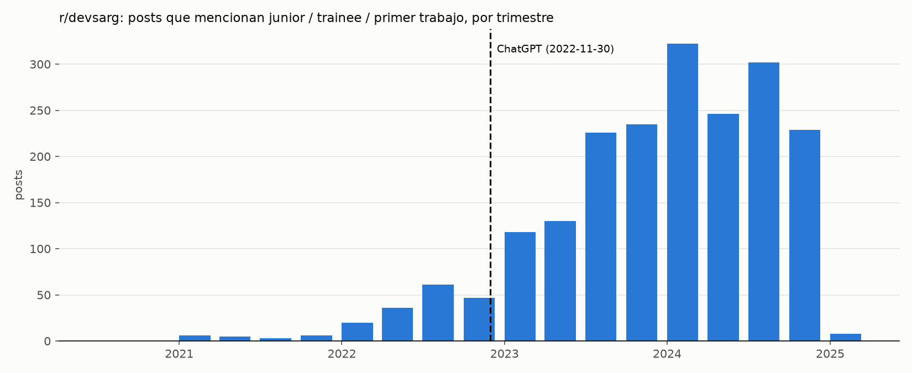

# 01. Chequeo de viabilidad (r/devsarg)

Fecha: 2026-10-16. Script: `scripts/viabilidad_reddit.py`.

## Objetivo

Antes de definir el corpus, medir si r/devsarg tiene suficientes posts sobre el primer trabajo antes del corte (2022-11-30) para comparar antes y después. Umbral fijado: unos 200 posts junior antes del corte.

## Método

- Fuente: API de [Arctic Shift](https://github.com/ArthurHeitmann/arctic_shift), endpoint `/api/posts/search`.
- Paginación por `created_utc` ascendente, 100 posts por request y 2 s de pausa entre requests.
- Filtro junior local (no con la búsqueda de la API): título o cuerpo, en minúsculas y sin tildes, con alguna de las palabras `junior`, `trainee`, `primer trabajo`, `primer laburo` o `sin experiencia`, como palabra completa y con plural opcional.

## Resultados

Datos desde el primer post (2020-08-09) hasta el 2025-01-03. Eso cubre todo el período previo al corte.

| | posts | junior | % junior | junior/mes |
|---|---|---|---|---|
| antes de 2022-11-30 | 2.114 | 162 | 7,7 | 5,8 |
| desde 2022-11-30 (hasta 2025-01) | 21.153 | 1.838 | 8,7 | 73,2 |

- El sub casi no tuvo actividad hasta 2022: menos de 100 posts por trimestre en 2021.
- Los posts junior tienen en promedio 22,8 comentarios (mediana 12). El 78% se capturó a menos de 2 días de publicado, así que `num_comments` está subestimado. Sin esos posts, el promedio es 26,5.
- Términos que no estaban en el filtro y suman posts junior antes del corte: `jr` (+53), `estudiante` (+35), `pasante/pasantía` (+17), `primer empleo` (+14).

## Problemas con la API

- La API devuelve `422 "Timeout. Maybe slow down a bit"` de forma intermitente. La misma request funciona segundos después. El script reintenta hasta 2 veces (30 s y 60 s) solo ante ese error y aborta ante cualquier otro.
- Los parámetros de búsqueda por texto (`query`, `title`) fallan más de la mitad de las veces por timeout. Por eso se descarga el sub completo y se filtra localmente.
- El endpoint de agregación (`/api/posts/search/aggregate`) dio timeout en todas las pruebas.

## Conclusión

162 posts junior antes del corte no alcanzan el umbral. De ahí salieron dos decisiones: ampliar la hipótesis al mercado laboral IT en general (todos los posts, no solo los junior) y sumar comentarios y otras fuentes.
