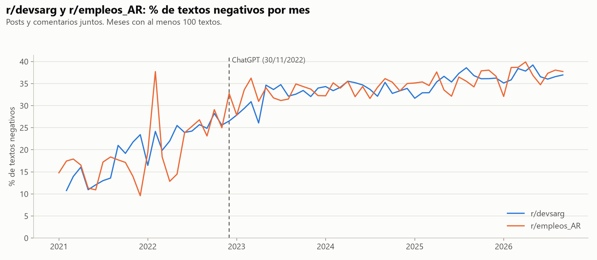
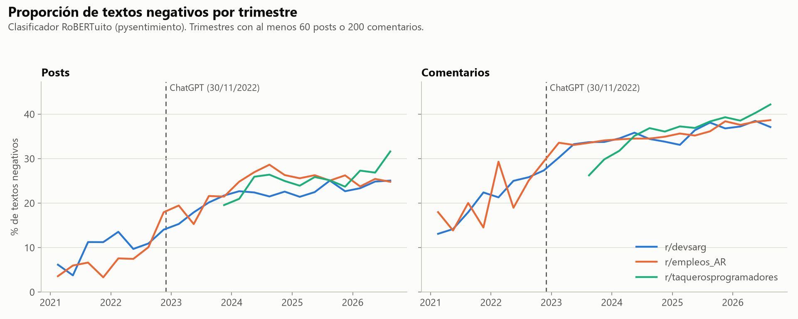
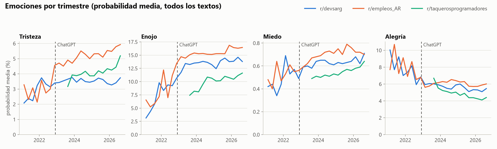

# 04. Tono: sentimiento y emociones

Scripts: `scripts/sentimiento.py` (inferencia, 2026-10-27 y 28, ~80 minutos en GPU) y `scripts/analisis_sentimiento.py` (agregación, ~3 minutos). Tablas en `reports/tablas/sent_*.csv`, figuras en `reports/figures/sent_*.png`.

## Pregunta

La hipótesis A dice que desde la llegada de ChatGPT la conversación sobre trabajo IT en Reddit se volvió más negativa. La pregunta concreta es si la proporción de textos negativos sube después del 2022-11-30, si el cambio ocurre en el corte o venía de antes, y si es propio de IT o también aparece en el mercado laboral argentino general (r/empleos_AR) y en otro país (r/taquerosprogramadores).

## Método

**Modelos.** Se clasificaron los 1.893.480 textos del corpus, sin muestrear, con dos modelos de [pysentimiento](https://github.com/pysentimiento/pysentimiento):

- `robertuito-sentiment-analysis`: negativo, neutro o positivo.
- `robertuito-emotion-analysis`: tristeza, enojo, miedo, alegría, sorpresa, asco u otra.

Los dos son RoBERTuito, un RoBERTa entrenado con tuits en español. Se eligió porque Reddit se parece más a Twitter que a los textos formales con que se entrenan otros modelos: frases cortas, lunfardo, ironía, emojis. Los textos pasan por el preprocesamiento de pysentimiento y se truncan a 128 tokens, el máximo del modelo. En posts largos se clasifica el título y el comienzo del cuerpo.

**Medidas.** Cada texto recibe la etiqueta de mayor probabilidad. La medida principal es el porcentaje de textos negativos por mes o trimestre, porque se lee directo. También se calcula la polaridad media (probabilidad de positivo menos probabilidad de negativo) y la probabilidad media de cada emoción.

**Intervalos de confianza.** Los comentarios de un mismo hilo no son independientes: si un post es una queja, sus respuestas tienden a serlo. Por eso los intervalos se calculan con un bootstrap de hilos (post más sus comentarios), con 500 réplicas de Poisson.

**¿El cambio ocurre en el corte?** Se ajusta una regresión segmentada sobre el % de textos negativos por mes: una recta antes del corte, un salto en diciembre de 2022 y otra pendiente después. Los errores son HAC (Newey-West, 6 rezagos) porque los meses consecutivos están autocorrelacionados. Noviembre de 2022 cuenta como "antes", porque el 97% de sus textos es anterior al 30. Se excluyen los meses con menos de 100 textos (el comienzo de r/devsarg).

**¿Es propio de IT?** Se compara el cambio de r/devsarg con el de r/empleos_AR (diferencia en diferencias). Si los dos suben lo mismo, el cambio no es específico de IT.

**Validación.** Se revisaron a mano 60 textos de r/devsarg elegidos al azar, 20 de cada etiqueta (`sent_validacion_etiquetas.csv`). La revisión la hizo una sola persona y conviene que el grupo la repita sobre la misma muestra.

## Resultados

### Validación del clasificador

| | manual: negativo | manual: neutro | manual: positivo |
|---|---|---|---|
| modelo: negativo | 14 | 5 | 1 |
| modelo: neutro | 1 | 19 | 0 |
| modelo: positivo | 1 | 3 | 16 |

Coinciden 49 de 60 textos (82%). El error más común es marcar como negativos textos neutros con tono crítico o técnico, por ejemplo un consejo sobre la vista cansada o una explicación sobre formatos de datos. También falla con la ironía ("una bomba laburar con el seguro", que es un elogio, sale negativo; "must be fun at parties", que es una burla, sale positivo). El nivel de negatividad está sobreestimado. Lo que se compara son cambios en el tiempo, que siguen siendo válidos si el error es parecido en todos los períodos.

### La negatividad sube, pero la subida empieza antes del corte

% de textos negativos por año (posts y comentarios juntos):

| Año | r/devsarg | r/empleos_AR | r/taquerosprogramadores |
|---|---|---|---|
| 2021 | 16,9 | 15,2 | |
| 2022 | 25,2 | 27,4 | |
| 2023 | 32,5 | 33,0 | 29,2 |
| 2024 | 34,1 | 34,2 | 34,7 |
| 2025 | 35,7 | 35,7 | 37,1 |
| 2026 | 37,0 | 37,3 | 39,7 |

En r/devsarg los textos negativos pasan de 17% en 2021 a 37% en 2026. La mitad de esa subida ocurre antes de ChatGPT. Entre enero de 2021 y noviembre de 2022 el porcentaje crece unos 0,8 puntos por mes. Después del corte crece mucho más lento.

Regresión segmentada, % de textos negativos por mes:

| | r/devsarg | r/empleos_AR |
|---|---|---|
| Pendiente antes del corte (puntos por mes) | 0,76 (IC 0,67 a 0,86) | 0,52 (0,33 a 0,71) |
| Salto en diciembre de 2022 (puntos) | 2,5 (0,8 a 4,2) | 7,0 (4,4 a 9,6) |
| Cambio de pendiente (puntos por mes) | −0,60 (−0,72 a −0,47) | −0,39 (−0,59 a −0,20) |
| Pendiente después del corte | 0,17 | 0,13 |

Hay un salto chico en el corte en r/devsarg (2,5 puntos), pero lo que domina es la tendencia previa. Si la subida de 2021 y 2022 hubiera seguido al mismo ritmo, la negatividad habría llegado a 45% a fines de 2024 y a 50% en la segunda mitad de 2025. En diciembre de 2024 estaba en 34%. En cambio, la curva se aplana desde 2023. ChatGPT coincide con el final de la subida, no con su comienzo.

### Posts y comentarios

| | Antes | Después | Cambio (puntos) |
|---|---|---|---|
| r/devsarg, posts | 11,0 (IC 9,6 a 12,4) | 22,3 (21,9 a 22,7) | +11,3 |
| r/devsarg, comentarios | 25,0 (23,9 a 26,0) | 35,4 (35,1 a 35,7) | +10,4 |
| r/empleos_AR, posts | 8,9 (7,4 a 10,4) | 25,0 (24,6 a 25,4) | +16,1 |
| r/empleos_AR, comentarios | 24,2 (22,3 a 26,6) | 36,0 (35,5 a 36,4) | +11,8 |

Los posts son menos negativos que los comentarios, porque muchos son preguntas neutras. Los dos tipos de texto se mueven igual.

### No es propio de IT ni de Argentina

Diferencia en diferencias (cambio de r/devsarg menos cambio de r/empleos_AR, en puntos de % de textos negativos):

| | Diferencia | IC 95% |
|---|---|---|
| Posts | −4,8 | −6,8 a −2,7 |
| Comentarios | −1,4 | −3,4 a 1,4 |
| Todos | −1,6 | −3,8 a 0,8 |

r/devsarg no se vuelve más negativo que r/empleos_AR. En comentarios y en el total la diferencia no es distinguible de cero, y en posts r/empleos_AR sube más. r/empleos_AR cambió de público durante 2022, de avisos de programación a trabajo en general (ver `05_temas.md`), así que la comparación antes del corte no es del todo limpia. Igual, las dos curvas mensuales son casi idénticas desde mediados de 2022.

r/taquerosprogramadores, el sub mexicano, no tiene datos antes del corte. Después sigue la misma trayectoria que los subs argentinos: 29% de textos negativos en 2023 y 40% en 2026. El aumento posterior al corte no depende de la economía argentina.

### Emociones

En r/devsarg, la probabilidad media de enojo pasa de 6,4% en 2021 a 13,2% en 2023 y después se mantiene (14,1% en 2026). La alegría baja de 8,3% a 5,3%. La tristeza y el miedo cambian poco (tristeza de 2,6% a 3,5%). El cambio de tono es sobre todo más enojo y menos alegría, no más tristeza o miedo. r/empleos_AR tiene más tristeza que r/devsarg desde el corte (5,7% contra 3,5% en 2026).

## Limitaciones

- **El clasificador sobreestima lo negativo.** De 20 textos que marcó como negativos, 6 no lo eran (5 neutros y 1 positivo). Las comparaciones en el tiempo suponen que ese error es estable. Si la forma de escribir cambió (más ironía, más insultos amistosos), parte del cambio puede ser del estilo y no del tono.
- **Truncado a 128 tokens.** En posts largos solo se clasifica el comienzo.
- **El crecimiento de los subs es un factor de confusión.** r/devsarg pasó de ~100 posts por trimestre en 2021 a más de 2.500 desde 2023. Una comunidad chica y nueva suele ser más amable que una masiva. La subida de 2021 y 2022 coincide con ese crecimiento, y este análisis no puede separar los dos efectos.
- **Correlación, no causalidad.** El corte coincide con los despidos tech globales, la suba de tasas de la Reserva Federal y la caída de avisos que empezó en 2022 (ver `08_mercado.md`). En Argentina, la devaluación de diciembre de 2023 y el fin del cepo de 2025 caen dentro del período "después".
- **Validación chica.** 60 textos revisados por una sola persona.

## Para la exposición

1. **La conversación se volvió más negativa, pero la subida empezó antes de ChatGPT.** En r/devsarg los textos negativos pasan de 17% en 2021 a 25% en 2022 y a 37% en 2026. Antes del corte crecían 0,76 puntos por mes; después, 0,17.
2. **No es propio de IT ni de Argentina.** r/empleos_AR, que habla de trabajo en general, sigue la misma curva que r/devsarg (diferencia en diferencias de −1,6 puntos, IC −3,8 a 0,8). El sub mexicano r/taquerosprogramadores sube igual desde 2023.
3. **El cambio de tono es más enojo y menos alegría.** El enojo se duplica entre 2021 y 2023 (de 6,4% a 13,2%) y la alegría baja de 8,3% a 5,3%.
