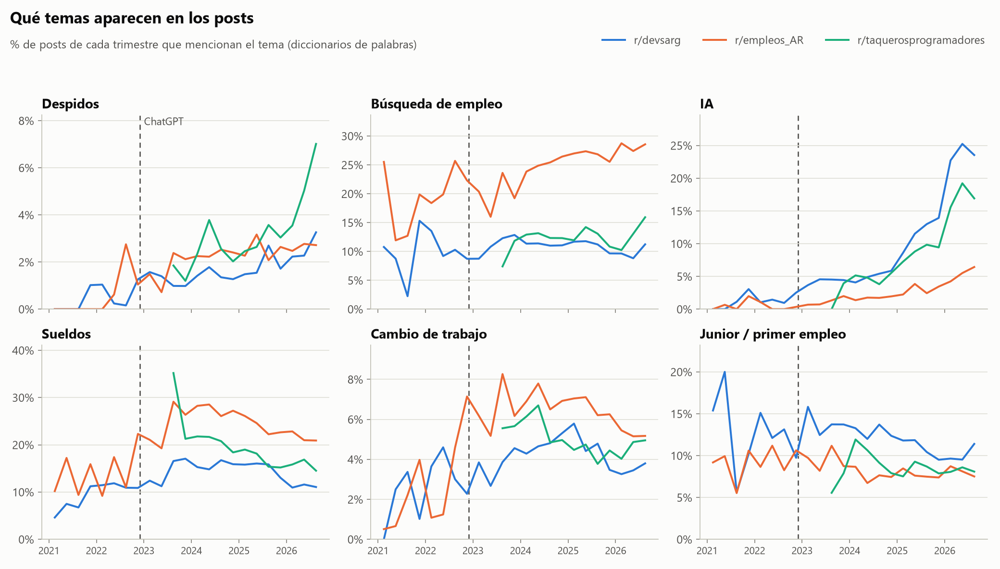
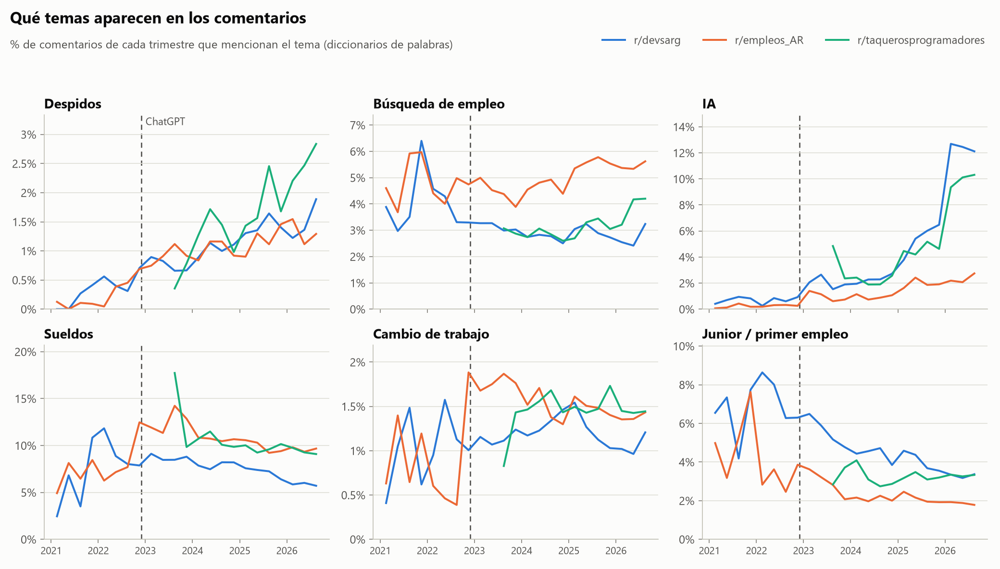
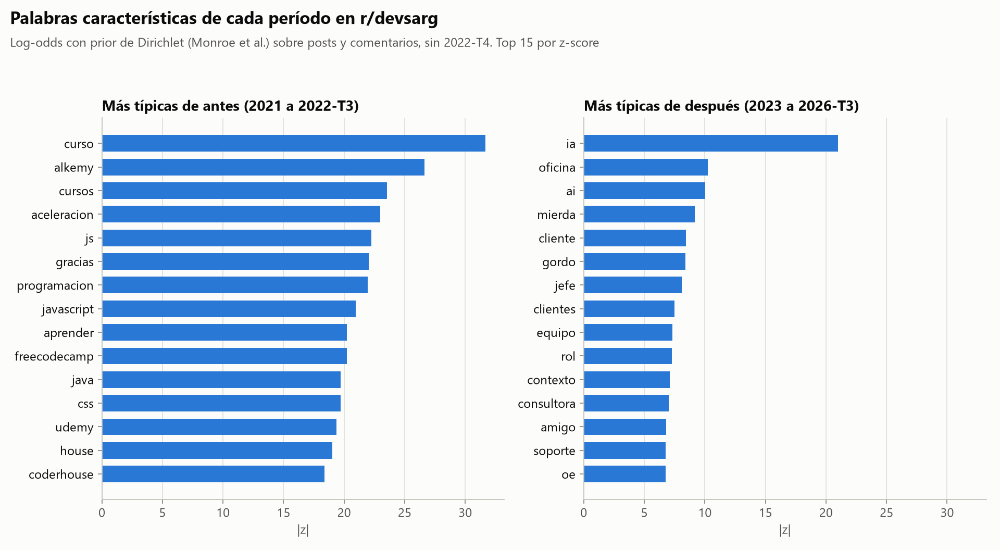
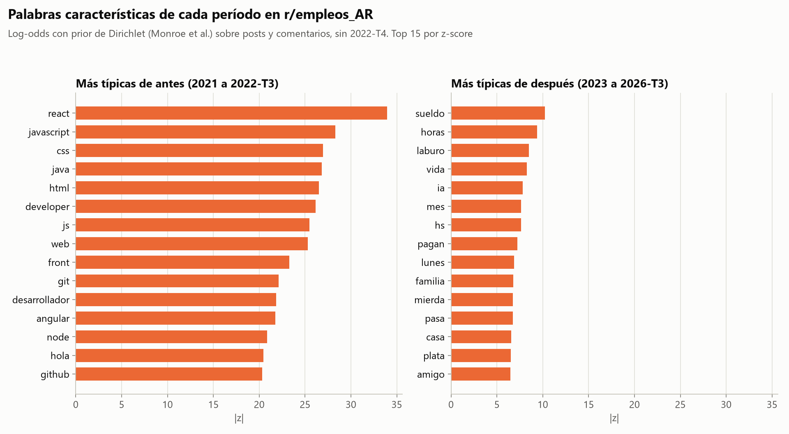
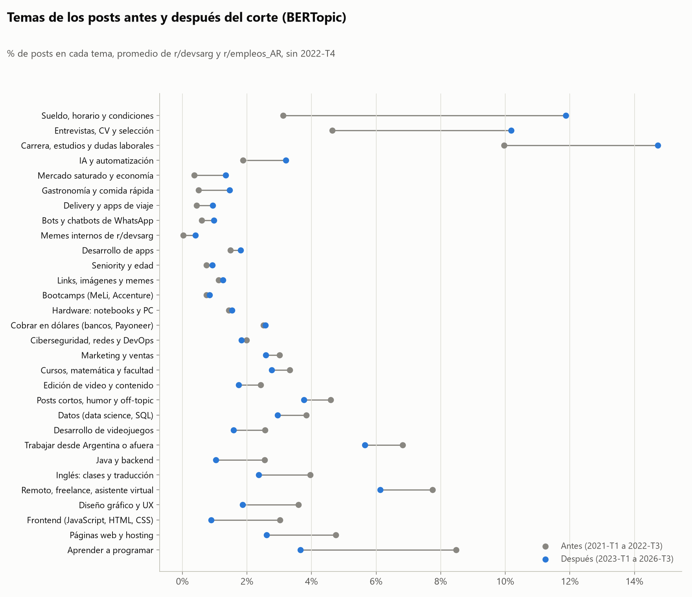
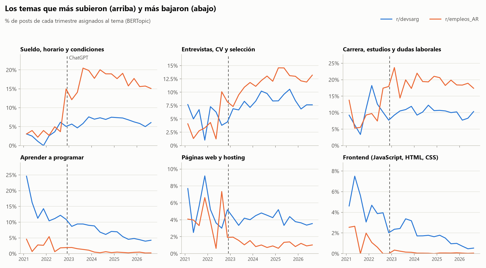

# 05. Temas de la conversación

Script: `scripts/analisis_temas.py` (2026-10-28, sobre el corpus con la deduplicación corregida: 5,8 minutos con los embeddings en caché y los temas de BERTopic ya ajustados; calcular los embeddings en la GPU suma 1 o 2 minutos y reajustar BERTopic otros 2). Lee `data/processed/posteos.jsonl` línea por línea y guarda solo los campos que usa.

```bash
python scripts/analisis_temas.py                      # las tres etapas
python scripts/analisis_temas.py --etapa diccionarios --muestra 40
python scripts/analisis_temas.py --etapa bertopic --reajustar   # vuelve a ajustar los temas
```

## Pregunta

La hipótesis A dice que después del 30/11/2022 se habla menos de sueldos y de cambiar de trabajo, y más de despidos, de lo difícil que es conseguir empleo y de la IA. Este documento cubre la parte de temas. El sentimiento va por separado.

Usamos tres métodos que se complementan. Los diccionarios miden temas definidos de antemano, los de la hipótesis. TF-IDF y log-odds muestran qué palabras distinguen cada período sin decidir antes qué buscar. BERTopic agrupa los posts por similitud de significado y deja ver temas que no estaban en la hipótesis.

## Método

### a) Diccionarios

Seis listas de expresiones regulares sobre el texto en minúsculas y sin tildes (se conserva la ñ), con límites de palabra. Incluyen plurales, conjugaciones, voseo y lunfardo (laburo, rajar, guita, lucas, palos) y algunas formas mexicanas (chamba, jale), porque r/taquerosprogramadores entra en la comparación. Las listas completas están en `DICCIONARIOS`, al principio del script.

| Tema | Qué cuenta | Ejemplos de patrones |
|---|---|---|
| Despidos | despidos propios o ajenos, layoffs, indemnización | despid*, me/lo/nos echaron, rajaron, layoff, desvincul*, recorte de personal |
| Búsqueda de empleo | buscar o no conseguir trabajo, postularse, desempleo | conseguir/buscar + laburo/trabajo/empleo, sin laburo, me postulé, me ghostearon, el mercado está saturado |
| IA | IA en general y herramientas concretas | ia, ai, chatgpt, gpt, llm, copilot, claude, gemini, vibe coding, prompt |
| Sueldos | salario y cuánto se cobra | sueldo, salario, brutos/netos, me pagan, cobro en dólares, 300 lucas, paritarias |
| Cambio de trabajo | renunciar, cambiar de empresa, ofertas nuevas | cambiar de laburo, renunciar, buscar otro trabajo, contraoferta, me ofrecieron |
| Junior / primer empleo | nivel de entrada | junior, jr, trainee, primer laburo, pasantía, sin experiencia, entry level |

Para validar cada diccionario el script guarda una muestra al azar de 40 coincidencias por tema, con el contexto alrededor (`--muestra 40`, semilla 42, en `reports/tablas/temas_validacion_muestra.csv`). La muestra validada es de la versión del corpus del 27/10; la corrección de la deduplicación sumó 790 textos y no cambia los diccionarios. Las leímos a mano y contamos cuántas hablan de verdad del tema. Hubo dos rondas de ajuste:

- Despidos: "telegrama" casi siempre era telegrama de renuncia y aparecía "me echaron de casa". Sacamos "telegrama" y excluimos "echaron de casa".
- Sueldos: "guita" sola, "cobran" y "usd 20k" tomaban impuestos, cursos y gastos. Ahora "cobrar" y "ganar" cuentan solo seguidos de un monto, una moneda o un adjetivo (bien, poco, el doble), y "lucas" solo con número.
- Cambio de trabajo: "otro trabajo" tomaba a quien tiene dos trabajos. Ahora cuenta solo con buscar, conseguir o pasarse a.
- Junior: "ssr" es semi senior, no junior. Lo sacamos.
- IA: sumamos "ai". En una muestra del 10% del corpus casi siempre era IA en inglés, no un "ahí" mal escrito.

| Tema | Precisión inicial | Precisión final (n = 40) |
|---|---|---|
| Despidos | 34/40 (85%) | 40/40 (100%) |
| Búsqueda de empleo | 38/40 (95%) | 38/40 (95%) |
| IA | sin medir bien en la primera ronda | 40/40 (100%) |
| Sueldos | 32/40 (80%) | 37/40 (92%) |
| Cambio de trabajo | 30/40 (75%) | 39/40 (98%) |
| Junior / primer empleo | 38/40 (95%) | 39/40 (98%) |

La precisión mide si lo que encuentra el diccionario es del tema. No medimos cobertura: un texto que habla de despidos sin usar ninguna de esas palabras no cuenta. Muchas coincidencias de despidos son consejos legales o hipotéticos ("si te echan te tienen que pagar"), no relatos de despidos. Para el tema eso alcanza, pero no es una medida de cuánta gente fue despedida.

Posts y comentarios van separados. Los comentarios son el 95% del corpus y se concentran en hilos largos, así que si los juntamos los posts casi no pesan y un solo hilo viral puede mover un trimestre. Los posts muestran de qué elige hablar la gente cuando abre un tema; los comentarios, de qué se habla en las respuestas. La tabla trimestral incluye además la suma de los dos (`tipo = todos`).

Para cada tema, subreddit, tipo y trimestre calculamos la proporción de textos con al menos una coincidencia. Antes es 2021-T1 a 2022-T3 y después es 2023-T1 a 2026-T3. El trimestre del corte (2022-T4) queda afuera de las dos puntas y 2026-T4 no entra porque está incompleto. Damos la proporción agregada y el promedio de las proporciones trimestrales, que no deja que los trimestres con más volumen dominen. El z de diferencia de proporciones es solo orientativo, porque los comentarios de un mismo hilo no son independientes.

### b) TF-IDF y log-odds

Sobre r/devsarg y r/empleos_AR, posts y comentarios juntos, con las stopwords en español de spaCy (normalizadas sin tildes), algunas en inglés y ruido de Reddit (https, x200b, risas).

Primero probamos TF-IDF con un documento por año. Con 6 documentos el idf casi no discrimina y las listas salían llenas de palabras comunes (laburo, años, empresa) y de basura de bloques de código pegados. La versión final:

- Un documento por trimestre (23 por subreddit).
- Frecuencia de documento: cada texto cuenta una vez por palabra, así un bloque de código que repite un identificador no pesa.
- tf = proporción de textos del trimestre que usan la palabra.
- idf = log(N / df), con df = trimestres en los que la palabra aparece en al menos 5 textos. Una palabra presente en todos los trimestres tiene idf 0, así que TF-IDF destaca lo que se concentra en algunos momentos.
- El puntaje de un período o de un año es el promedio de sus trimestres. Exigimos al menos 30 textos con la palabra.

Como complemento usamos log-odds con prior de Dirichlet informativo (Monroe, Colaresi y Quinn, 2008), antes contra después. El prior es la frecuencia de la palabra en todo el subreddit, escalada a 1.000 pseudo-cuentas. A diferencia de TF-IDF, compara directamente los dos períodos y corrige por la diferencia de tamaño. Como "antes" es chico, los z del lado "antes" son más altos que los del lado "después".

### c) BERTopic

Sobre los 83.630 posts de r/devsarg y r/empleos_AR (título y cuerpo):

- Embeddings con `paraphrase-multilingual-MiniLM-L12-v2` en la GPU, en media precisión. Quedan en `data/processed/temas_embeddings.npy`, con los ids en orden en `temas_embeddings_ids.txt`. Si los ids coinciden, el script los reusa.
- UMAP (15 vecinos, 5 dimensiones, semilla 42) y HDBSCAN (tamaño mínimo 150). Salen 67 temas y 46,6% de posts atípicos.
- Reducción a 30 temas. En una prueba con 25 quedaba un tema que juntaba entrevistas, sueldos y dudas de carrera en un 24% de los posts; con 30 se separa en tres temas legibles.
- c-TF-IDF con CountVectorizer en español (unigramas y bigramas, mismas stopwords). Hubo que pasar `language="multilingual"`. Con el valor por defecto, BERTopic borra los caracteres no ASCII antes de calcular las palabras de cada tema y quedaban "espaa" o "diseo".
- 193 posts cuyo título y cuerpo fueron borrados ("[deleted by user]") no tienen contenido. Quedan como tema -2.

#### Asignación estable

La primera versión asignaba los temas directamente con BERTopic. Cuando corregimos la deduplicación, el corpus sumó 140 posts (0,17%) y la nueva corrida dio temas distintos. 23 de los 30 temas cambiaron de número o de contenido. Por ejemplo, "Tecnologías (Java, .NET, JS)" se partió en "Java y backend" y "Frontend", y apareció un tema de "Mercado saturado y economía" que antes estaba repartido. UMAP y HDBSCAN dependen del conjunto completo de puntos, así que cualquier cambio del corpus puede reordenar los temas aunque la semilla sea fija.

Para que eso no pase, el script separa el ajuste de la asignación:

1. BERTopic se ajusta una vez. Para cada uno de los 30 temas guardamos el centroide de sus posts en el espacio de embeddings, en `reports/modelos/temas_centroides.npz`, que está en el repo para que cualquiera que corra el script obtenga los mismos temas.
2. Cada post se asigna al centroide más cercano por similitud del coseno. Si la similitud es menor a 0,4, queda como atípico (tema -1). Con ese umbral queda un 4,2% de atípicos.
3. Las palabras de cada tema salen del c-TF-IDF de BERTopic calculado sobre esa asignación. Los posts representativos son los 3 más cercanos al centroide.

Las corridas siguientes reusan los centroides. La asignación de un post depende solo de su embedding y de los centroides, así que agregar o sacar posts no cambia el tema de los demás ni los nombres. Para volver a ajustar hay que pedirlo con `--reajustar` y revisar los nombres. El costo es que los temas quedan fijados en el corpus del 28/10: un tema nuevo que aparezca después no tendría centroide propio.

Nombramos los temas a mano leyendo las 10 palabras y los 3 posts más cercanos al centroide de cada uno (`temas_bertopic_temas.csv`). En el script cada nombre lleva una palabra de control que tiene que estar entre las 10 del tema. Si un reajuste da temas distintos, el script avisa y usa las palabras clave en lugar de un nombre equivocado. En la corrida final no hubo avisos.

Para comparar períodos promediamos las proporciones trimestrales de cada tema y después promediamos los dos subreddits, así r/devsarg y r/empleos_AR pesan igual. La asignación por post está en `data/processed/temas_posts.parquet` (id, tema_id, tema_nombre), para cruzarla con sentimiento.

## Resultados

### Diccionarios

Porcentaje de textos que mencionan cada tema, antes (2021-T1 a 2022-T3) y después (2023-T1 a 2026-T3):

| Tema | devsarg posts | devsarg comentarios | empleos_AR posts | empleos_AR comentarios | Hipótesis |
|---|---|---|---|---|---|
| Despidos | 0,32 → 1,74 | 0,35 → 1,18 | 0,35 → 2,44 | 0,18 → 1,14 | sube: se cumple |
| Búsqueda de empleo | 10,2 → 11,0 | 3,88 → 2,87 | 19,0 → 26,0 | 4,75 → 5,11 | sube: mixto |
| IA | 1,15 → 10,5 | 0,66 → 5,28 | 0,53 → 3,20 | 0,22 → 1,64 | sube: se cumple |
| Sueldos | 10,6 → 14,5 | 8,50 → 7,42 | 12,7 → 24,2 | 6,83 → 10,4 | baja: no se cumple, salvo comentarios de devsarg |
| Cambio de trabajo | 3,25 → 4,28 | 1,21 → 1,20 | 1,85 → 6,32 | 0,69 → 1,49 | baja: no se cumple |
| Junior / primer empleo | 12,9 → 12,0 | 7,07 → 4,25 | 8,99 → 8,01 | 4,07 → 2,14 | (no está en la hipótesis) baja |

Tabla completa, con el promedio trimestral y el z, en `reports/tablas/temas_diccionario_periodo.csv`.





Las series trimestrales cambian la lectura de algunos promedios:

- IA no salta en el corte. En los comentarios de r/devsarg pasa de 0,9% en 2022-T4 a 2,1% en 2023-T1, se queda entre 1,5% y 2,7% hasta fines de 2024, sube a 3,8 a 6,5% en 2025 y llega a 12,7% en 2026-T1. La mayor parte del aumento llega dos o tres años después de ChatGPT, con las herramientas de programación (Claude, Cursor, agentes). r/taquerosprogramadores sigue la misma curva que r/devsarg desde 2023-T3.
- Despidos crece de forma gradual. En los comentarios de r/devsarg pasa de 0,3 a 0,5% en 2021 y 2022 a 0,7% en 2022-T4, 0,9% en 2023-T1 y 1,9% en 2026-T3. La subida empieza antes del corte, junto con los despidos tech de 2022, y sigue sin un salto puntual.
- Junior cae desde antes del corte. En los comentarios de r/devsarg el pico es 8,6% en 2022-T1 y la caída arranca en 2022-T2. En 2026 está en 3,4%.
- Búsqueda de empleo y sueldos bajan en los comentarios de r/devsarg (de 3,9 a 2,9% y de 8,5 a 7,4%), pero suben en r/empleos_AR, sobre todo en los posts. El salto de sueldos en r/empleos_AR (de 12,7 a 24,2% de los posts) ocurre en 2023 y coincide con el cambio de qué se publica en ese subreddit, que se ve en TF-IDF y BERTopic, y con la inflación alta de 2023.
- Cambio de trabajo no baja en ningún subreddit. En los posts de r/empleos_AR se triplica.

### TF-IDF

Top 10 por período de TF-IDF en r/devsarg (top 20 por período y por año en `temas_tfidf_devsarg.csv`):

| Rango | Antes | Después |
|---|---|---|
| 1 | alkemy | ia |
| 2 | egg | claude |
| 3 | aceleracion | chatgpt |
| 4 | comprar | contractor |
| 5 | pago | oficina |
| 6 | pesos | senior |
| 7 | alla | mierda |
| 8 | senior | sr |
| 9 | coderhouse | op |
| 10 | usd | gordo |

Por año, en r/devsarg, "chatgpt" es la palabra 1 de 2023, "ia" la 1 de 2024 a 2026, y en 2025 y 2026 aparecen vibe, cursor, codex, opencode, agentes, opus, tokens, llm, slop y mcp. Antes destacan las aceleradoras y academias (Alkemy, Egg, Coderhouse).

En r/empleos_AR el período anterior está dominado por vocabulario de avisos IT (nodejs, vue, angular, developers, mysql, frameworks, node, git). Después aparecen ia, viernes, compañeros, hijos, obra, gastronomía, alquiler, gobierno, palos y milei. El subreddit pasó de ser sobre todo de avisos de programación a hablar de trabajo en general y de la economía.

### Log-odds





En r/devsarg las palabras más típicas de antes son de aprender a programar (curso, alkemy, cursos, aceleración, js, programación, javascript, aprender, freecodecamp, udemy, coderhouse). Las de después son de la vida laboral y de la IA (ia, oficina, ai, cliente, jefe, equipo, rol, consultora, soporte, oe por overemployment, rrhh) y también insultos y apodos (mierda, gordo, pelotudo), que van al análisis de tono.

En r/empleos_AR antes dominan tecnologías (react, javascript, css, java, html, developer) y después sueldo, horas, laburo, vida, ia, mes, pagan, familia, plata y blanco (por "en blanco").

### BERTopic





Porcentaje de posts por tema (promedio de las proporciones trimestrales) en los temas que más cambian. Tabla completa en `temas_bertopic_cambio.csv`.

| Tema | Antes (prom. 2 subs) | Después | devsarg antes → después | empleos_AR antes → después |
|---|---|---|---|---|
| Sueldo, horario y condiciones | 3,1 | 11,9 | 2,7 → 6,5 | 3,5 → 17,3 |
| Entrevistas, CV y selección | 4,6 | 10,2 | 5,4 → 8,3 | 3,9 → 12,0 |
| Carrera, estudios y dudas laborales | 10,0 | 14,7 | 10,2 → 10,2 | 9,8 → 19,3 |
| IA y automatización | 1,9 | 3,2 | 2,2 → 5,6 | 1,5 → 0,8 |
| Mercado saturado y economía | 0,4 | 1,3 | 0,6 → 2,0 | 0,1 → 0,7 |
| Gastronomía y comida rápida | 0,5 | 1,5 | 0,0 → 0,2 | 1,0 → 2,8 |
| Diseño gráfico y UX | 3,6 | 1,9 | 1,0 → 0,8 | 6,2 → 2,9 |
| Páginas web y hosting | 4,8 | 2,6 | 5,3 → 4,1 | 4,2 → 1,1 |
| Java y backend | 2,5 | 1,0 | 2,8 → 2,0 | 2,2 → 0,1 |
| Frontend (JavaScript, HTML, CSS) | 3,0 | 0,9 | 4,8 → 1,7 | 1,3 → 0,1 |
| Aprender a programar | 8,5 | 3,7 | 14,3 → 6,6 | 2,6 → 0,7 |

- En r/devsarg cae "Aprender a programar", de 14,3 a 6,6% de los posts, y también "Frontend" (4,8 a 1,7%). Suben "Sueldo, horario y condiciones" (2,7 a 6,5%), "IA y automatización" (2,2 a 5,6%), "Entrevistas, CV y selección" (5,4 a 8,3%) y "Mercado saturado y economía" (0,6 a 2,0%). La caída de "Aprender a programar" es una tendencia que viene desde 2021 (24,6% en 2021-T1, 10,9% en 2022-T4, 4,3% en 2026-T3), no un escalón en el corte.
- El tema de IA en r/devsarg sigue la misma curva que el diccionario. Está entre 2% y 3,5% de los posts hasta 2024, sube a 6,6 a 7,2% en 2025 y a 10,4 a 11,6% en 2026.
- En r/empleos_AR los saltos coinciden con el crecimiento del subreddit, que pasó de 109 posts en 2022-T3 a 569 en 2022-T4. "Sueldo, horario y condiciones" pasa de 3,7% a 15,0% en ese trimestre y "Carrera, estudios y dudas laborales" de 7,5% en 2022-T2 a 17,4% en 2022-T3. Junto con la caída de los temas de programación (Java 2,2 a 0,1%, Frontend 1,3 a 0,1%) y la subida de gastronomía y delivery, indica que el subreddit cambió de público.
- El tema de IA mezcla IA generativa con QA automation, que existía antes del corte. Por eso arranca en 2,2% en r/devsarg y no en cero.
- No sale un tema propio de despidos. Para eso, la medida es el diccionario.

## Limitaciones

- Correlación, no causalidad. En el mismo período hay despidos tech globales (2022 y 2023), la devaluación de diciembre de 2023, inflación alta y cambio de gobierno. Varias tendencias (despidos, junior, aprender a programar) empiezan antes del corte.
- El período "antes" es chico. r/devsarg tiene entre 65 y 98 posts por trimestre en 2021, así que esa parte de las series de posts es ruidosa. Los comentarios (miles por trimestre) son más estables.
- Los subreddits cambiaron de composición. r/empleos_AR pasó de avisos IT a trabajo en general, y eso explica buena parte de sus subas en sueldos, búsqueda y cambio de trabajo. Comparar sus proporciones antes y después mezcla el cambio de tema con el cambio de público.
- Los diccionarios tienen precisión alta (92 a 100%) pero no medimos cobertura. Los niveles absolutos subestiman cada tema; las tendencias son más confiables que los niveles.
- La validación la hizo una sola persona, con 40 casos por tema. Con n = 40, una precisión de 95% tiene un intervalo de confianza aproximado de 83 a 99%.
- r/taquerosprogramadores empieza en 2023-T3 con 846 comentarios y 2 posts. El primer punto de sus series (por ejemplo 18% de sueldos en comentarios) es inestable.
- BERTopic depende de parámetros (tamaño mínimo de cluster, número de temas, umbral de atípicos) y del corpus exacto. Con 140 posts más (0,17%) el ajuste dio otros temas, por eso fijamos los centroides. Entre las dos corridas la foto general se mantuvo: suben sueldo y condiciones, entrevistas e IA, y caen aprender a programar y las tecnologías. Los límites entre temas y los nombres son una decisión nuestra.
- El 3,4% de posts sin texto antes del corte, contra 0,4% después, muestra que los posts viejos se borraron más.
- El z de diferencia de proporciones supone textos independientes, y los comentarios de un hilo no lo son.

## Para la exposición

1. La IA es el cambio más grande, pero no llega con ChatGPT. En los comentarios de r/devsarg la menciona el 0,7% antes del corte, alrededor del 2% en 2023 y 2024, y el 12% en 2026. El salto grande es de 2025 y 2026, con las herramientas para programar.
2. Despidos se multiplica por 3 en r/devsarg (de 0,35 a 1,18% de los comentarios) y por 6 en r/empleos_AR (de 0,18 a 1,14%), pero sube de forma gradual desde 2022 y no en el corte.
3. La parte de "menos sueldos y menos cambio de trabajo" no se cumple. En r/empleos_AR los posts que hablan de sueldos pasan de 12,7 a 24,2% y los de cambio de trabajo de 1,9 a 6,3%. Lo que más cae en r/devsarg es aprender a programar: de 14,3 a 6,6% de los posts según BERTopic, con cursos y academias como las palabras más típicas de antes.
