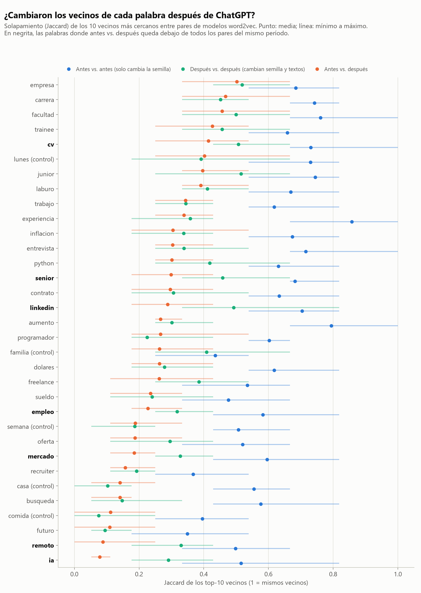
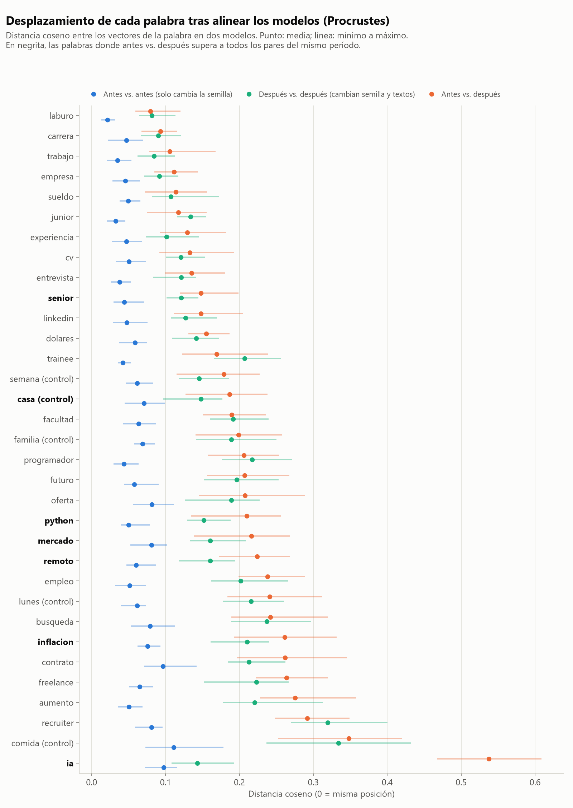

# 06. Vocabulario: vecinos de palabras clave antes y después del corte

Fecha: 2026-10-28. Script: `scripts/analisis_vocabulario.py` (11,2 minutos en CPU, 4 hilos). Tablas en `reports/tablas/vocab_*.csv`. Log de la corrida en `data/processed/logs/vocab.log`.

Las cifras son de la segunda corrida, hecha sobre `posteos.jsonl` después de corregir la deduplicación (ver `docs/03_consolidacion.md`). La primera corrida usó el corpus anterior, con 13 textos menos en "antes". La sección "Estabilidad entre corridas" compara las dos.

## Pregunta

Hipótesis C: después de 2022 cambió el vocabulario con que se habla del trabajo IT, y palabras como "trabajo", "junior" o "empresa" aparecen asociadas a términos distintos que antes.

La pregunta concreta es si los vecinos más cercanos de cada palabra en un modelo word2vec entrenado antes del 2022-11-30 difieren de los de un modelo entrenado después, más de lo que difieren dos modelos del mismo período.

## Método

**Corpus.** Posts y comentarios de r/devsarg y r/empleos_AR juntos. r/taquerosprogramadores queda afuera porque no tiene datos antes del corte. Se descartan los textos con menos de 2 tokens.

| Corpus | Textos | Tokens |
|---|---|---|
| Antes (completo) | 50.624 | 2.253.546 |
| Después (completo, no se entrena) | 1.488.812 | 58.111.141 |
| Después, cada una de las 5 submuestras | 57.578 a 58.334 | 2.253.684 a 2.254.152 |

**Submuestras de "después".** El período posterior tiene 26 veces más tokens. Un modelo entrenado con más texto tiene vecinos más estables y distintos, y eso se confundiría con un cambio de sentido. Por eso cada submuestra toma textos al azar de "después" hasta igualar los tokens de "antes" en cada estrato (subreddit por tipo de texto). Así la mezcla de posts y comentarios y de los dos subs es la misma en los dos períodos. Las 5 submuestras son independientes y comparten pocos textos (2.406 entre la 1 y la 2, el 4%).

**Tokenización.** Minúsculas, se decodifican las entidades HTML y se borran las URLs. Las tildes se quitan y la ñ se conserva. En Reddit muchos escriben sin tildes ("programacion", "dolares"), así que conservarlas partiría cada palabra en dos tokens con frecuencias menores. La ñ distingue palabras ("año" y "ano") y casi nadie la omite. Los tokens salen de la regex `[a-zñ0-9]+[+#]*`, que conserva "c#" y "c++". Se descartan los tokens de una letra y los números sueltos. Se unifican tres abreviaturas del foro: "jr" pasa a "junior", "sr" a "senior" y "ssr" a "semisenior". No se usan frases de varias palabras (Phrases).

**Modelos.** Word2vec skip-gram de gensim 4.4, 100 dimensiones, ventana 5, `min_count=10`, 10 muestras negativas, 15 épocas. Con un corpus chico skip-gram representa mejor las palabras poco frecuentes que CBOW, y las 15 épocas compensan el poco texto. Se entrenan 5 modelos de "antes" (el mismo corpus con semillas 42 a 46) y 5 de "después" (submuestra *i* con semilla 42+*i*). El vocabulario queda en 10.243 palabras antes y unas 10.800 después. Con 4 hilos gensim no es determinista aunque la semilla esté fija, así que una nueva corrida da números algo distintos. Esa variación entra en el ruido de base, y la sección "Estabilidad entre corridas" muestra cuánto mueve el resultado.

**Palabras objetivo.** Las 11 de la consigna, 18 más del tema y 5 palabras de control que no deberían cambiar con ChatGPT (semana, casa, familia, comida, lunes). Se analizan las que aparecen al menos 100 veces en "antes". Quedan 33 de 35. Salen "despidos" (10 apariciones antes) y "chatgpt" (0).

**Medida de cambio.** Para cada par de modelos y cada palabra se calcula el Jaccard de sus 10 vecinos más cercanos (1 si son los mismos, 0 si no comparten ninguno). Hay tres tipos de pares:

- antes contra antes (10 pares): solo cambia la semilla;
- después contra después (10 pares): cambian la semilla y los textos;
- antes contra después (25 pares): lo que se quiere medir.

Una palabra cuenta como cambio claro si el Jaccard medio antes contra después queda por debajo del mínimo de los 20 pares del mismo período. Es un criterio exigente a propósito.

El ruido de "antes" está subestimado. No hay otro corpus de "antes" contra el cual comparar, así que esos pares solo miden el efecto de la semilla. El ruido comparable con antes contra después es el de después contra después, donde dos modelos se entrenan con textos distintos del mismo tamaño. En casi todas las palabras ese es el ruido que define el umbral.

Como segunda medida se alinea cada par de modelos con Procrustes ortogonal sobre el vocabulario común y se calcula la distancia coseno del vector de la palabra. El criterio es el mismo: antes contra después tiene que superar a todos los pares del mismo período.

La tabla de vecinos toma, para cada período, los 10 vecinos con mayor similitud media en los 5 modelos. Entre paréntesis va en cuántos de los 5 top-10 individuales aparece cada vecino.

## Resultados

### Frecuencias

Apariciones en "antes", media por submuestra de "después" y tasa por millón de tokens en cada período completo (`vocab_frecuencias.csv`).

| Palabra | Antes | Después (submuestra) | Por millón antes | Por millón después |
|---|---|---|---|---|
| trabajo | 6.168 | 6.407 | 2.737 | 3.085 |
| laburo | 6.137 | 5.796 | 2.723 | 2.637 |
| experiencia | 5.014 | 4.270 | 2.225 | 1.919 |
| empresa | 4.154 | 4.213 | 1.843 | 1.833 |
| carrera | 3.575 | 2.648 | 1.586 | 1.209 |
| cv | 1.904 | 2.075 | 845 | 1.016 |
| sueldo | 1.750 | 2.156 | 777 | 1.007 |
| junior | 1.704 | 1.168 | 756 | 468 |
| python | 1.540 | 690 | 683 | 273 |
| linkedin | 1.526 | 1.057 | 677 | 468 |
| entrevista | 1.195 | 1.427 | 530 | 658 |
| dolares | 1.132 | 906 | 502 | 404 |
| mercado | 1.079 | 1.338 | 479 | 566 |
| senior | 1.029 | 1.043 | 457 | 406 |
| programador | 856 | 518 | 380 | 210 |
| remoto | 785 | 900 | 348 | 407 |
| trainee | 745 | 364 | 331 | 144 |
| empleo | 473 | 463 | 210 | 227 |
| recruiter | 267 | 168 | 118 | 69 |
| ia | 147 | 2.073 | 65 | 808 |
| despidos (excluida) | 10 | 54 | 4 | 24 |
| chatgpt (excluida) | 0 | 321 | 0 | 127 |

La tabla completa, con las 35 palabras, está en el CSV. Las frecuencias ya muestran un cambio que no necesita word2vec: "ia" pasa de 65 a 808 por millón de tokens (12 veces más), "junior" baja de 756 a 468 y "trainee" de 331 a 144.

### Cambio de vecinos contra el ruido de base

| Palabra | Antes vs. antes | Después vs. después | Antes vs. después | Cambio claro (Jaccard) | Cambio claro (coseno) |
|---|---|---|---|---|---|
| ia | 0,51 | 0,29 | 0,08 | sí | sí |
| remoto | 0,50 | 0,33 | 0,09 | sí | sí |
| mercado | 0,60 | 0,33 | 0,18 | sí | sí |
| empleo | 0,58 | 0,32 | 0,23 | sí | no |
| linkedin | 0,70 | 0,49 | 0,29 | sí | no |
| senior | 0,68 | 0,46 | 0,30 | sí | sí |
| cv | 0,73 | 0,51 | 0,41 | sí | no |
| trabajo | 0,62 | 0,34 | 0,34 | no | no |
| laburo | 0,67 | 0,41 | 0,39 | no | no |
| junior | 0,74 | 0,52 | 0,40 | no | no |
| empresa | 0,68 | 0,52 | 0,50 | no | no |
| entrevista | 0,72 | 0,34 | 0,30 | no | no |
| sueldo | 0,48 | 0,24 | 0,24 | no | no |
| programador | 0,60 | 0,22 | 0,27 | no | no |
| dolares | 0,62 | 0,28 | 0,26 | no | no |
| recruiter | 0,37 | 0,19 | 0,16 | no | no |
| inflacion | 0,67 | 0,34 | 0,30 | no | sí |
| python | 0,63 | 0,42 | 0,30 | no | sí |
| casa (control) | 0,55 | 0,10 | 0,14 | no | sí |
| lunes (control) | 0,73 | 0,39 | 0,40 | no | no |

Valores: Jaccard medio de los top-10 vecinos. Las 33 palabras están en `vocab_cambio.csv` y los 45 pares por palabra en `vocab_pares.csv`.

Para "trabajo", "empresa", "laburo" y "sueldo", el solapamiento antes contra después es igual al de dos submuestras de "después" entre sí. Por ejemplo, "trabajo" da 0,34 en los dos casos y "empresa" 0,50 contra 0,52. Con este método no se puede distinguir un cambio en esas palabras del ruido de entrenar con textos distintos. "junior" queda en un punto intermedio. Su media antes contra después (0,40) está por debajo de la media de después contra después (0,52), pero no del mínimo de los pares del mismo período (0,25), así que no pasa el criterio. En la primera corrida las dos medias eran casi iguales (0,40 y 0,42).

Siete palabras pasan el criterio de Jaccard: ia, remoto, mercado, empleo, linkedin, senior y cv. Ninguna palabra de control lo pasa. Con la distancia coseno pasan siete, entre ellas el control "casa". Por eso el coseno sirve como confirmación y no como criterio único. Las dos medidas coinciden en cuatro palabras: ia, remoto, mercado y senior.

### Estabilidad entre corridas

La primera corrida (2026-10-27, corpus antes de corregir la deduplicación) y la segunda dan listas parecidas pero no iguales. Los corpus difieren en 13 textos de "antes" y 336 de "después", así que casi toda la diferencia viene de las submuestras y de los hilos de gensim, no de los datos. Una palabra que entra o sale del criterio entre corridas está cerca del umbral.

| Palabra | Jaccard, corrida 1 | Jaccard, corrida 2 | Coseno, corrida 1 | Coseno, corrida 2 |
|---|---|---|---|---|
| ia | sí | sí | sí | sí |
| remoto | sí | sí | sí | sí |
| mercado | sí | sí | sí | sí |
| senior | sí | sí | no | sí |
| linkedin | sí | sí | sí | no |
| cv | sí | sí | no | no |
| recruiter | sí | no | no | no |
| empleo | no | sí | no | no |
| inflacion | no | no | sí | sí |
| casa (control) | no | no | sí | sí |
| entrevista | no | no | sí | no |
| programador | no | no | sí | no |
| aumento | no | no | sí | no |
| python | no | no | no | sí |

- Pasan Jaccard en las dos corridas seis palabras: ia, remoto, mercado, senior, linkedin y cv.
- "recruiter" salió del criterio. En la corrida 1 daba 0,15 antes contra después frente a 0,26 de después contra después. En la corrida 2 da 0,16 frente a 0,19, y el mínimo del mismo período bajó a 0,11.
- "empleo" entró. En la corrida 1 daba 0,29 antes contra después frente a 0,26 de después contra después. En la corrida 2 da 0,23 frente a 0,32, apenas debajo del mínimo del mismo período (0,25).
- Solo ia, remoto y mercado pasan las dos medidas en las dos corridas. Son los resultados firmes.
- Por coseno, "casa" pasa en las dos corridas aunque es un control. La medida coseno da más falsos positivos que Jaccard.

### Vecinos antes y después

Top-10 por similitud media en los 5 modelos de cada período. Entre paréntesis, en cuántos de los 5 modelos el vecino está en el top-10 individual (`vocab_vecinos.csv`).

**Palabras con cambio claro (Jaccard, corrida 2)**

| Palabra | Antes | Después |
|---|---|---|
| ia | artificial (5), ciencia (5), cientificos (5), ai (5), ciencias (4), estadistica (4), computacion (3), science (4), inteligencia (3), machine (1) | ai (5), chatgpt (5), ias (4), agentes (3), llm (4), llms (2), claude (2), gpt (2), reemplazar (2), herramienta (2) |
| remoto | relocalizacion (5), latam (4), españa (5), remota (4), colombia (4), afuera (5), home (3), mix (4), time (2), chile (3) | hibrido (5), full (5), presencial (4), contractor (4), fulltime (3), time (3), afuera (4), lun (2), hibrida (2), homeoffice (2) |
| mercado | saturado (5), insercion (5), insertarse (5), saturada (5), mundo (5), ambito (4), trainees (4), saturando (4), satura (3), mercadolibre (0) | saturado (5), saturadisimo (5), mundo (5), rubro (5), destruido (4), panorama (2), ambito (2), saturacion (1), dolar (0), entry (0) |
| empleo | trabajo (5), laburo (5), empleos (5), jooble (5), portales (5), portal (4), computrabajo (3), registrate (4), zonajobs (4), conseguir (2) | trabajo (5), laburo (5), empleos (5), chamba (5), laborales (3), trabajos (3), bumeran (2), indeed (1), pasantias (1), computrabajo (0) |
| linkedin | recruiters (5), perfil (5), computrabajo (5), spamear (5), cv (5), postulate (3), behance (5), feed (3), bumeran (4), registrate (4) | computrabajo (5), indeed (5), zonajobs (5), bumeran (5), cv (4), recruiters (5), perfil (3), portales (3), feed (2), busquedas (2) |
| senior | semisenior (5), semi (5), junior (5), jr+ (5), ssr+ (5), staff (5), developer (5), mid (3), advance (3), engineer (2) | semisenior (5), junior (5), semi (5), dev (5), trainee (5), engineer (3), mid (2), lead (2), developer (1), architect (2) |
| cv | curriculum (5), cvs (5), linkedin (5), portfolio (5), portafolio (5), perfil (5), bouvetfernanda (4), hotmail (5), memoriastudioproyect (4), curriculums (2) | curriculum (5), cvs (5), linkedin (5), ats (4), perfil (5), portfolio (4), curriculums (5), portafolio (3), computrabajo (2), foto (2) |

**Palabras de la consigna sin cambio claro**

| Palabra | Antes | Después |
|---|---|---|
| trabajo | laburo (5), empleo (5), trabajar (5), trabajos (5), puesto (5), estadia (5), trabajando (5), socio (3), remoto (2), temporal (1) | laburo (5), empleo (5), trabajar (5), trabajos (5), puesto (3), remoto (3), laburito (2), laburar (1), trabajando (1), chamba (1) |
| laburo | trabajo (5), empleo (5), laburito (5), laburos (5), laburar (5), conseguirlo (4), puesto (5), estadia (3), laburando (2), volantazo (4) | trabajo (5), empleo (5), laburito (5), laburos (5), laburar (5), laburando (1), chamba (1), puesto (1), rubro (2), lugar (1) |
| junior | trainee (5), semisenior (5), senior (5), jr+ (5), dev (5), juniors (5), semi (5), 210k (4), mid (3), desarrollador (3) | trainee (5), senior (5), semisenior (5), dev (5), semi (4), fullstack (4), developer (4), desarrollador (2), mid (2), devops (1) |
| empresa | consultora (5), compañia (5), pyme (5), multinacional (5), startup (5), factory (5), mediana (5), posicion (3), aerolinea (3), fintech (3) | consultora (5), startup (5), pyme (5), compañia (5), multinacional (5), posicion (5), factory (2), agencia (3), negrera (3), industria (1) |
| entrevista | tecnica (5), entrevistas (5), grupal (5), charla (5), reunion (5), evaluacion (5), challenge (5), prueba (5), hackerrank (2), agendar (1) | grupal (5), entrevistas (5), reunion (5), tecnica (5), reclutadora (2), charla (2), llamaron (3), preocupacional (2), psicotecnico (2), challenge (1) |
| sueldo | salario (5), aumento (5), bruto (5), neto (5), paritarias (4), rango (3), seniority (3), dolarizado (3), 350k (1), 42k (4) | salario (5), neto (4), bruto (5), monto (3), 900k (3), pretendido (2), aumento (2), rango (2), 5m (1), 2m (2) |
| programador | desarrollador (5), dev (5), programadora (5), ingeniero (5), developer (5), abap (5), ilustrador (4), diseñador (3), estudiante (2), musico (3) | dev (5), desarrollador (5), ingeniero (5), arquitecto (1), analista (1), junior (2), consultor (2), estudiante (2), diseñador (2), economista (0) |
| dolares | pesos (5), usd (5), crocantes (5), verdes (5), dolarucos (5), 1000usd (5), dls (5), lechugas (3), rucula (2), euros (1) | pesos (5), usd (5), euros (5), dls (3), verdes (4), 5k (2), crocantes (2), 10k (1), 2k (1), 3k (1) |

Lectura de los cambios claros:

- **ia.** Antes era un término académico (ciencia, científicos, estadística). Después sus vecinos son productos y modelos (chatgpt, claude, llm, gpt, agentes) y "reemplazar", que aparece en 2 de 5 modelos.
- **remoto.** Antes se asociaba a trabajar para afuera (relocalización, latam, España, Colombia, Chile). Después es una modalidad más, al lado de híbrido y presencial.
- **mercado.** "Saturado" es vecino en los dos períodos. Después se suman "saturadisimo", "rubro", "destruido" (4 de 5 modelos) y "panorama".
- **empleo.** Antes estaba cerca de portales y sitios de búsqueda (Jooble, Computrabajo, ZonaJobs, "registrate"). Después esos vecinos pierden peso y aparece "chamba" en los 5 modelos. Es la palabra que entró al criterio en esta corrida, así que es un resultado al borde.
- **linkedin.** Antes estaba cerca de recruiters, "spamear" y Behance. Después está entre portales de empleo (Indeed, ZonaJobs, Bumeran).
- **cv.** Aparece "ats" (sistemas de filtrado automático de postulaciones) en 4 de los 5 modelos de después y en ninguno de antes.
- **senior** cambia sobre todo en vecinos de forma: las abreviaturas "jr+" y "ssr+" de antes contra "lead" y "architect" de después. Es un cambio en cómo se escriben los niveles más que de tema.

## Limitaciones

- **El corpus de antes es chico para estabilizar vecinos.** Con 2,25 millones de tokens, dos modelos entrenados con textos distintos del mismo período comparten en promedio entre el 8% (comida) y el 52% (empresa, junior) de sus 10 vecinos. Para "sueldo" el valor es 0,24. Con ese nivel de ruido, solo se detectan cambios grandes. Un cambio moderado en "trabajo" o "junior" puede existir y quedar debajo del umbral.
- **El resultado cambia entre corridas.** Dos corridas con el mismo método difieren en una palabra por Jaccard (recruiter sale, empleo entra) y en seis por coseno. Solo ia, remoto y mercado pasan las dos medidas en las dos corridas.
- **El ruido de antes está subestimado.** No hay un segundo corpus de antes, así que antes contra antes solo mide la semilla (Jaccard 0,35 a 0,86). Se usa el ruido de después como referencia del ruido entre corpus distintos. Si "antes" fuera más homogéneo que "después", el umbral sería algo laxo.
- **Pocos autores pesan mucho antes.** En un corpus chico, los textos repetidos de una sola cuenta meten vecinos raros: "bouvetfernanda" y "memoriastudioproyect" (cv), "210k" (junior, trainee) y "estadia" (trabajo, laburo). La consolidación descarta textos idénticos del mismo autor, pero no plantillas parecidas.
- **El umbral de frecuencia es bajo para "ia".** Tiene 147 apariciones antes, cerca del mínimo de 100. Igual sus vecinos de antes son estables entre semillas (Jaccard 0,51) y el cambio es el más grande de todos (0,08) en las dos corridas.
- **La distancia coseno marca un control.** "casa" pasa el criterio de coseno en las dos corridas. Por eso los cambios que se reportan como firmes son los que pasan Jaccard, y los que pasan las dos medidas son los más sólidos.
- **Correlación, no causalidad.** El corte coincide con los despidos tech globales de 2022-2023 y con la devaluación argentina de diciembre de 2023. El cambio en "remoto" tiene más relación con la vuelta a la oficina y los contratos con el exterior que con ChatGPT. Solo "ia" tiene una relación directa con el lanzamiento.
- **Un solo corte.** "Después" junta casi cuatro años. Un cambio que haya pasado en 2025 se mezcla con 2023.
- La tokenización no une "jr+" ni "ssr+" con "junior" y "semisenior". La regex conserva el "+" y la tabla de sinónimos solo cubre "jr", "sr" y "ssr" sin signo.

## Para la exposición

1. **"IA" cambió de significado.** Antes del corte sus vecinos eran ciencia, científicos y estadística. Después son chatgpt, claude, llm, agentes y "reemplazar". El solapamiento de vecinos entre períodos es 0,08, contra 0,29 entre dos muestras del mismo período, y el resultado se repite en las dos corridas. Además su frecuencia pasó de 65 a 808 por millón de tokens.
2. **"Trabajo", "junior" y "empresa" no muestran un cambio medible.** Su solapamiento antes contra después (0,34, 0,40 y 0,50) no queda por debajo del ruido entre muestras del mismo período (medias de 0,34, 0,52 y 0,52, y mínimos de 0,25 a 0,43). La hipótesis C se cumple para un grupo chico de palabras (ia, remoto y mercado firmes en las dos corridas) y no para las que nombra.
3. **"Remoto" pasó de "trabajar para afuera" a "modalidad".** Antes sus vecinos eran relocalización, latam y España. Después son híbrido y presencial. Jaccard entre períodos 0,09, contra 0,33 entre muestras de después.
