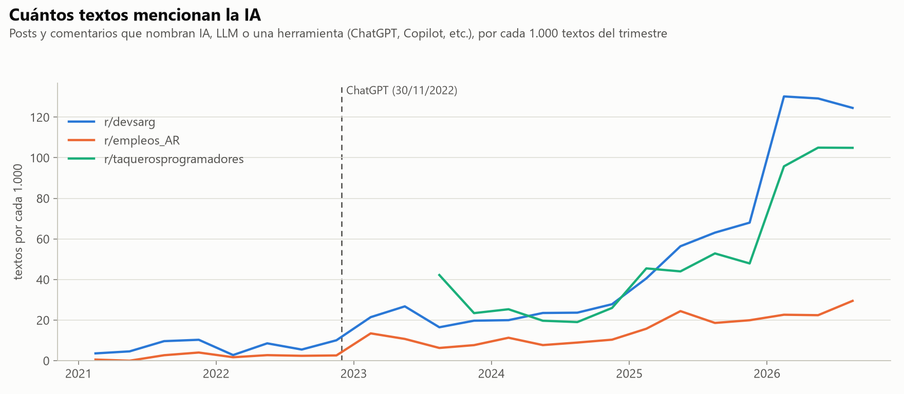
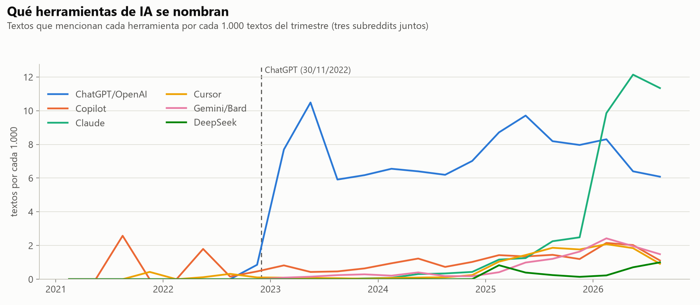
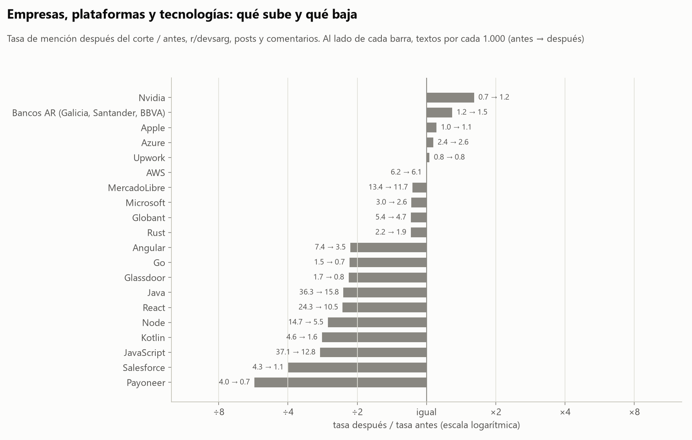

# 07. Actores: entidades nombradas y herramientas de IA

Script: `scripts/analisis_entidades.py` (2026-10-28). La última corrida completa tardó 608 s en CPU: ~4,5 minutos de NER y ~5,5 del resto del análisis. Con `--reusar-ner` el script usa la caché `data/processed/ent_ner_posts.jsonl` y se saltea spaCy. Las tablas quedan en `reports/tablas/ent_*.csv` y las figuras en `reports/figures/ent_*.png`.

## Pregunta

La propuesta pide mirar los actores de la conversación (empresas, tecnologías y herramientas de IA) y su frecuencia en el tiempo. Este análisis prueba una parte de la hipótesis A: si después del corte se habla más de la IA. También mira qué actores pierden lugar, porque eso dice algo sobre el cambio de temas, y qué herramientas de IA dominan en cada momento.

## Método

Usamos dos mediciones porque ninguna alcanza sola.

**NER con spaCy.** Corrimos `es_core_news_lg` con solo el componente `ner` sobre los 99.216 posts de los tres subs. El texto es el título más el cuerpo, truncado a 2.000 caracteres. Quedan las etiquetas ORG, MISC, PER y LOC. Normalizamos cada entidad a minúsculas, sacamos la puntuación de los bordes y unificamos alias ("mercado libre", "meli" y "mercado pago" pasan a "mercadolibre"; "eeuu" y "usa" pasan a "estados unidos"). Para los rankings descartamos saludos y muletillas ("hola", "saludos", "gracias") y los spans de más de tres palabras, que casi siempre son frases que el modelo marcó como MISC. La comparación antes/después usa solo r/devsarg y r/empleos_AR, porque r/taquerosprogramadores no tiene datos antes del corte. La unidad es el post: contamos en cuántos posts aparece cada entidad por cada 1.000 posts del período.

**Diccionario curado.** Armamos una lista de 68 actores en cinco categorías: herramientas de IA (ChatGPT/OpenAI, Copilot, Claude, Cursor, Gemini/Bard, DeepSeek y "otras"), IA como tema genérico ("IA", "inteligencia artificial", "LLM", "vibe coding"), empresas, plataformas de empleo y tecnologías. Cada actor es una expresión regular. El diccionario es barato, así que lo aplicamos a los 1.893.480 textos, posts y comentarios. Eso da 52.050 textos antes del corte en los subs argentinos, contra 3.582 posts si usáramos solo posts. La medida es la cantidad de textos que mencionan el actor por cada 1.000 textos del trimestre.

Algunos términos son ambiguos y los tratamos aparte:

- "AI" en minúscula suele ser "ahí" mal escrito, así que solo cuenta en mayúscula. "IA" cuenta en cualquier caso.
- "meta" es una palabra común. Meta cuenta solo como "Meta" con mayúscula y sin dos puntos después, o como "Facebook" o "Zuckerberg".
- "cursor" también es el cursor del mouse o de una base de datos. No lo filtramos. La tasa antes del corte (0,2 por 1.000 en r/devsarg) sirve de línea de base del falso positivo.

El script guarda 15 contextos al azar de cada término ambiguo por período (`ent_dic_contextos.csv`). Los leímos todos. En Claude, Gemini y ChatGPT no hay falsos positivos. Los 8 casos de "cursor" antes del corte son todos el cursor del mouse o de SQL, y los 15 de después son todos el editor Cursor. "IA" antes del corte aparece como carrera o materia ("la licenciatura en inteligencia artificial", "Técnicas de IA"); después aparece como algo que actúa ("la AI mató la contratación de juniors").

Para no leer trimestres con pocos datos, la figura por subreddit omite los trimestres con menos de 500 textos. Eso deja afuera 2023-T2 de r/taquerosprogramadores, que tiene 2 textos. El ranking de cambios exige al menos 20 textos antes del corte, porque con menos la razón de tasas sale de dividir por casi cero.

## Resultados

### Calidad del NER

Tomamos 50 entidades al azar de las 508.947 que encontró el modelo (semilla 42, `ent_ner_muestra.csv`) y las revisamos a mano.

| Resultado | Entidades | Ejemplos |
|---|---|---|
| Correcta, span y etiqueta | 13 | IBM (ORG), YPF (ORG), LinkedIn (ORG), USA (LOC), Bitcoin (MISC) |
| Entidad real con etiqueta equivocada | 2 | Mercado Libre (LOC), Dokan (LOC) |
| Inicio de oración o muletilla con mayúscula | 19 | "Estoy" (PER), "Gracias!", "Me" (ORG), "Soy egresado de Ingeniería Mecatrónica" |
| Sustantivo común con mayúscula | 10 | "Ingeniero" (LOC), "CRM" (ORG), "Ingeniería Industrial" (ORG), "Data Entry" |
| Abreviatura o jerga | 3 | "dev", "Jr+" (LOC), "ing" (ORG) |
| Código, URL u otro idioma | 3 | una URL de imagen, fórmulas de Power Apps, "Cara" en un texto en portugués |

Solo 15 de las 50 son entidades reales, y 13 tienen la etiqueta correcta. El modelo se entrenó con noticias y Wikipedia. En Reddit confunde cualquier palabra con mayúscula con una entidad y etiqueta MISC casi todo (32 de 50).

También medimos al revés: de las menciones que encuentra el diccionario en los posts, cuántas caen dentro de una entidad del NER (`ent_ner_cobertura.csv`). Reconoce el 98% de "Python" y el 97% de "Gemini", pero solo el 56% de "ChatGPT", el 50% de "Cursor" y el 24% de "AWS". Cuando las reconoce, a veces les pone una etiqueta equivocada. Claude sale como persona en 726 de 851 casos, y MercadoLibre sale como lugar (849) o persona (755) más que como organización (447).

Por esto las series de frecuencia usan el diccionario. El NER sirve para descubrir actores que no estaban en la lista.

### Lo que encuentra el NER

Las entidades del NER con más crecimiento en los posts de los subs argentinos confirman lo que mide el diccionario (`ent_ner_cambios.csv`):

| Entidad | Posts antes | Posts después | Por 1.000 posts antes | Por 1.000 posts después |
|---|---|---|---|---|
| ia | 12 | 2.512 | 3,4 | 31,4 |
| chatgpt | 0 | 417 | 0,0 | 5,2 |
| claude | 0 | 296 | 0,0 | 3,7 |
| gemini | 0 | 111 | 0,0 | 1,4 |
| claude code | 0 | 98 | 0,0 | 1,2 |
| cv | 70 | 3.306 | 19,5 | 41,3 |

El NER también encontró actores que no estaban en el diccionario. Carrefour (196 posts), McDonald's (141) y Coto (136) no aparecen antes del corte. Vienen de r/empleos_AR, que después de 2023 tiene mucho más de trabajo fuera de IT. "ARCA" (130) es la agencia de recaudación que reemplazó a la AFIP en 2024. Entre las que caen están las academias y cursos de programación: Alkemy (de 6,4 a 0,3 por 1.000 posts), Argentina Programa (3,9 a 0,5), Digital House (2,8 a 0,4), freeCodeCamp (5,0 a 0,8) y Coderhouse.

El ranking de entidades más frecuentes (`ent_ner_top_periodo.csv`) tiene ruido incluso después de filtrar: "estoy", "ahora" y "necesito" están entre las 30 primeras. Lo dejamos como tabla de referencia, no como resultado.

### Cuánto se habla de IA

Textos (posts y comentarios) que mencionan la IA, sea en forma genérica o por una herramienta, por cada 1.000 textos (`ent_ia_trimestral.csv`):

| Año | r/devsarg | r/empleos_AR | r/taquerosprogramadores |
|---|---|---|---|
| 2021 | 7,7 | 1,8 | |
| 2022 | 7,8 | 2,5 | |
| 2023 | 20,4 | 9,0 | 24,6 |
| 2024 | 23,6 | 9,6 | 22,4 |
| 2025 | 57,5 | 19,6 | 47,3 |
| 2026 (hasta T3) | 128,2 | 24,9 | 101,7 |

En r/devsarg la tasa se multiplica por 2,6 en 2023 respecto de 2022 y después se estabiliza en ~20 por 1.000 durante dos años. El salto grande llega en 2025 y 2026. En 2026, uno de cada ocho textos de r/devsarg menciona la IA. r/taquerosprogramadores sigue casi la misma curva que r/devsarg desde 2023, así que el aumento no es algo propio de Argentina. En r/empleos_AR la IA crece pero queda en 25 por 1.000, que es lo esperable en un sub de empleo general.

Si se cuentan solo las herramientas con nombre (ChatGPT, Claude, etc.), r/devsarg pasa de 1,8 por 1.000 en 2022 a 10,3 en 2023 y a 37,4 en 2026.

### Qué herramientas de IA se nombran

Participación de cada herramienta sobre el total de menciones de herramientas, por trimestre, con los tres subs juntos (`ent_ia_participacion.csv`):

| Trimestre | ChatGPT/OpenAI | Claude | Copilot | Cursor | Gemini/Bard |
|---|---|---|---|---|---|
| 2023-T2 | 92% | 0% | 4% | 1% | 1% |
| 2024-T2 | 73% | 3% | 14% | 1% | 5% |
| 2025-T1 | 61% | 8% | 10% | 7% | 3% |
| 2025-T4 | 49% | 15% | 7% | 11% | 10% |
| 2026-T1 | 31% | 36% | 8% | 8% | 9% |
| 2026-T3 | 25% | 47% | 5% | 4% | 6% |

ChatGPT tiene el 84% de las menciones o más en cada trimestre de 2023. Copilot es la segunda herramienta en 2023 y 2024, con un pico de 14% en 2024-T2. Cursor y Gemini suben durante 2025. Claude supera a ChatGPT en 2026-T1 y llega al 47% de las menciones en 2026-T3. En tasa, Claude pasa de 2,5 a 9,9 textos por 1.000 entre 2025-T4 y 2026-T1, mientras que ChatGPT queda alrededor de 6 a 8. ChatGPT tiene 0 menciones antes del 30/11/2022, lo que sirve de control del diccionario. Copilot tiene algunas menciones en 2021 y 2022, cuando GitHub Copilot estaba en versión preliminar.

DeepSeek aparece de golpe en 2025-T1 (6% de las menciones), que coincide con el lanzamiento de DeepSeek-R1 en enero de 2025, y después baja.

### Empresas, plataformas y tecnologías

Textos por cada 1.000 en r/devsarg y r/empleos_AR, antes y después del corte (`ent_dic_periodo.csv`):

| Actor | Antes | Después | Después / antes |
|---|---|---|---|
| IA, inteligencia artificial | 4,4 | 26,8 | 6,1 |
| ChatGPT/OpenAI | 0,0 | 7,2 | |
| Claude | 0,0 | 3,2 | |
| LinkedIn | 27,3 | 16,3 | 0,59 |
| JavaScript | 27,8 | 7,6 | 0,27 |
| Java | 26,0 | 9,2 | 0,36 |
| Python | 20,9 | 8,3 | 0,39 |
| React | 18,7 | 6,1 | 0,33 |
| Google | 11,9 | 7,8 | 0,65 |
| MercadoLibre | 11,1 | 8,4 | 0,76 |
| Globant | 4,4 | 2,8 | 0,63 |
| Payoneer | 3,3 | 0,7 | 0,21 |
| Nvidia | 0,7 | 1,1 | 1,61 |

Casi todos los actores que no son de IA bajan. Los que más caen son los lenguajes y frameworks. En r/devsarg solo, JavaScript pasa de 37,1 a 12,8 por 1.000 y Java de 36,3 a 15,8 (`ent_dic_periodo_devsarg.csv`). Las empresas caen menos. MercadoLibre baja de 13,4 a 11,7 y Globant de 5,4 a 4,7 en r/devsarg, y siguen siendo los empleadores más nombrados. Nvidia es de los pocos actores que crecen, y es el que más se asocia con la IA.

La caída de las tecnologías va en la misma dirección que la caída de las academias en el NER. Antes del corte r/devsarg tenía más preguntas de gente que estaba aprendiendo ("¿qué lenguaje aprendo?", "¿hago Digital House?"), y después la conversación gira hacia el mercado y la IA. Esto encaja con el cambio de temas de la hipótesis A, pero este análisis no alcanza para probarlo. Los análisis de temas lo pueden confirmar o descartar.

## Limitaciones

- **El NER rinde mal en este corpus.** 15 de 50 entidades al azar son reales, y 13 tienen la etiqueta correcta. Las conclusiones de frecuencia salen del diccionario, que solo encuentra lo que pusimos en la lista.
- **El diccionario tiene sesgos de diseño.** Algunos actores ambiguos se dejaron afuera (Llama, "Go" como palabra) o se restringieron (Meta con mayúscula, "AI" en mayúscula). "IA" incluye usos que no hablan de herramientas, como la carrera o la materia. Revisamos 15 contextos por período de los términos ambiguos, no una muestra grande.
- **El período antes es chico.** En los subs argentinos son 52.050 textos antes contra 1.534.800 después. Las tasas de 2021 en r/devsarg salen de 554 a 1.067 textos por trimestre y por eso saltan.
- **Composición de los subs.** r/empleos_AR cambió de público después de 2023 y tiene más trabajo fuera de IT. Eso baja por sí solo la tasa de tecnologías en los subs argentinos juntos. Por eso la figura de cambios usa solo r/devsarg. La figura de herramientas junta los tres subs, y r/taquerosprogramadores entra recién en 2023-T3. La participación de cada herramienta depende menos de esa mezcla que la tasa.
- **2022-T4 es un trimestre mixto.** Tiene dos meses antes del corte y uno después. En las tablas antes/después cada texto va al período que le corresponde por su fecha.
- **Es correlación.** El crecimiento de las menciones de IA coincide con los despidos tech de 2022 y 2023, con la devaluación de diciembre de 2023 y con lanzamientos de modelos. No separamos esos efectos.

## Para la exposición

1. **La IA pasó de tema marginal a tema central, pero el salto grande no fue en 2022.** En r/devsarg, los textos que mencionan la IA pasan de 7,8 por 1.000 en 2022 a 20,4 en 2023, se mantienen dos años y llegan a 128 por 1.000 en 2026, uno de cada ocho textos. r/taquerosprogramadores, en México, sigue la misma curva.
2. **ChatGPT dominó hasta 2025 y en 2026 lo pasó Claude.** ChatGPT tenía el 92% de las menciones de herramientas en 2023-T2 y el 25% en 2026-T3. Claude pasó del 0% al 47% en ese tiempo.
3. **Se habla menos de lenguajes y cursos.** En r/devsarg, JavaScript baja de 37 a 13 textos por 1.000 y Java de 36 a 16. Academias como Alkemy y Digital House casi desaparecen de los posts. Los empleadores grandes como MercadoLibre y Globant se mantienen.
