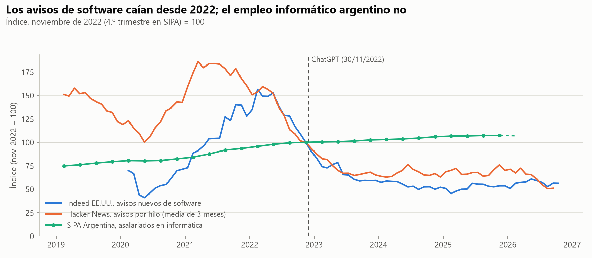
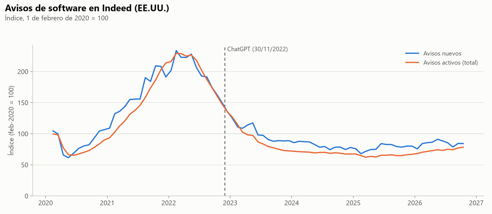
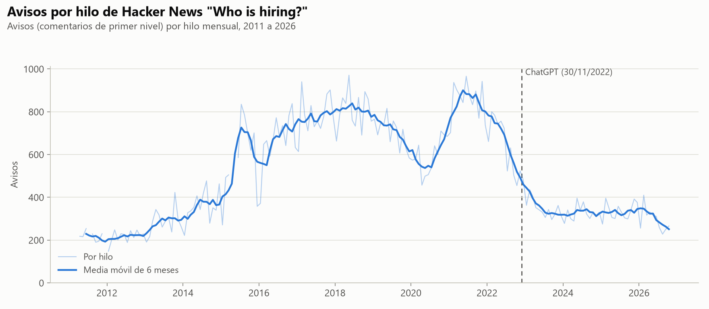
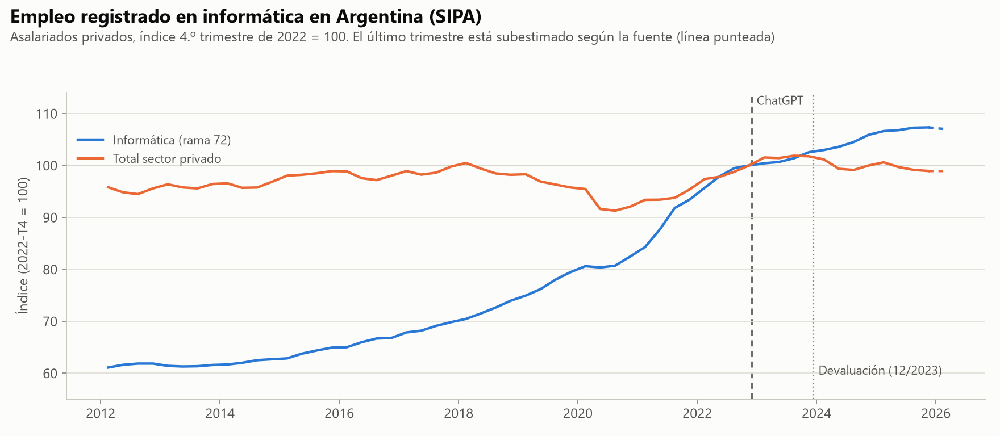
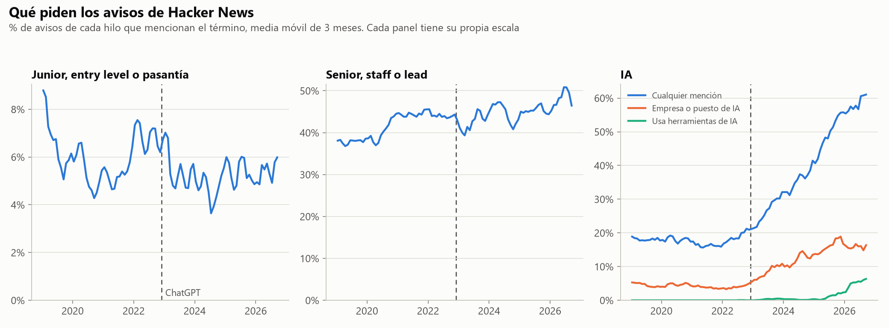
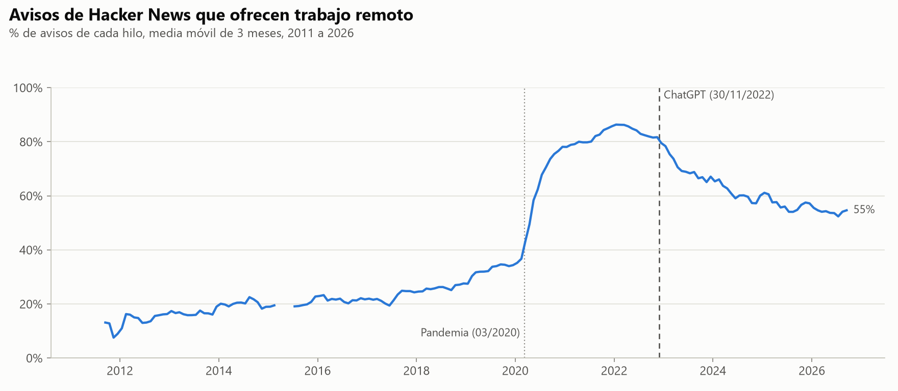

# 08. Mercado y ofertas

Script: `scripts/analisis_mercado.py` (2026-10-27, ~55 segundos en CPU). Lee `data/processed/` y escribe las series en `data/processed/mercado_mensual.csv` y `data/processed/mercado_trimestral.csv`, las tablas en `reports/tablas/mercado_*.csv` y las figuras en `reports/figures/mercado_*.png`.

## Pregunta

La hipótesis B dice que el sentimiento en Reddit se mueve junto con la cantidad de ofertas de software. Este documento arma el lado de las ofertas. El cruce con el sentimiento se hace aparte, con las dos series de salida.

Preguntas concretas:

- ¿Cuándo cayó la demanda de programadores y cuánto, según tres fuentes distintas?
- ¿Cambió qué piden los avisos? En particular, si hay menos puestos junior, más senior y más menciones de IA.

## Método

**Fuentes de demanda.** Se usan tres series que miden cosas distintas:

- Indeed Hiring Lab, avisos de software en EE.UU. (`new postings` y `total postings`), mensual desde 2020-02, índice base 100 en el 2020-02-01.
- Hacker News "Who is hiring?", cantidad de avisos por hilo mensual, desde 2011-04. Es una muestra chica y sesgada hacia startups de EE.UU. y Europa, pero es la única con texto antes y después del corte.
- SIPA, asalariados registrados en la rama 72 (informática) en Argentina, trimestral. No mide ofertas sino empleo, que reacciona más lento. El último trimestre (2026-T1) está subestimado según la fuente y se dibuja punteado.

Para comparar las tres en un mismo gráfico se reindexan con base noviembre de 2022 = 100 (2022-T4 en SIPA). Así se ve cuánto subió o bajó cada una respecto del mes del corte, sin doble eje. La serie de Hacker News se suaviza con media móvil centrada de 3 meses porque varía mucho de un hilo a otro.

**Composición de los avisos de Hacker News.** Cada aviso se marca con diccionarios de expresiones regulares en inglés:

| Medida | Qué busca |
|---|---|
| junior | junior, jr, entry level, new grad, recent grad, graduate role/program, intern, internship (excluye "micro-internship", que es una etapa de entrevista) |
| senior | senior, sr, staff engineer, principal engineer, tech lead, team lead, lead engineer |
| ia | AI, A.I., ML, LLM, GenAI, NLP, machine learning, deep learning, artificial intelligence, large language model, generative AI, ChatGPT, GPT-n, OpenAI, neural net, computer vision |
| ia_encabezado | el diccionario de IA en la primera línea del aviso, donde va "Empresa \| Puesto \| Lugar" |
| ia_herramientas | GitHub Copilot, Cursor, Claude Code, Windsurf, "AI-assisted development", "AI coding tools", "experience with AI tools", "agentic coding", "vibe coding" y variantes |
| remoto | remote, remotely, work from home, WFH, fully distributed, salvo "no remote", "not remote", "Remote: No" |

Los diccionarios de IA distinguen mayúsculas para que "AI" y "ML" no coincidan con palabras comunes. Los demás no las distinguen.

La IA se separa en tres medidas porque "menciona IA" mezcla cosas distintas. `ia_encabezado` aproxima "trabaja en IA": la empresa o el puesto son de IA (por ejemplo "Resemble AI \| Deep Learning Researcher"). `ia_herramientas` aproxima "trabaja con IA": el aviso pide o describe el uso de asistentes para programar. Lo que queda de `ia` sin estas dos son menciones en la descripción del producto o del stack.

Cada porcentaje es la proporción de avisos del hilo que contienen al menos una coincidencia. Un aviso puede listar puestos junior y senior a la vez, así que las medidas no suman 100.

**Validación.** El script saca 30 coincidencias al azar de cada diccionario desde 2019 (semilla 42) y las guarda en `reports/tablas/mercado_validacion_muestras.csv`. Las etiqueté a mano: una coincidencia es correcta si el aviso ofrece ese tipo de puesto (junior, senior), menciona IA, es de una empresa o un puesto de IA, pide o usa herramientas de IA para programar, u ofrece trabajo remoto. Las etiquetas y el motivo de cada error están en `reports/tablas/mercado_validacion_etiquetas.csv`. Solo se mide la precisión; la cobertura (avisos junior que el diccionario no detecta) no se estimó.

## Resultados

### Precisión de los diccionarios

| Diccionario | Correctas de 30 | Precisión | Errores típicos |
|---|---|---|---|
| junior | 27 | 0,90 | "intern or junior roles are not open", "mentoring junior developers" en un puesto senior |
| senior | 28 | 0,93 | describe al equipo actual ("our team of senior engineers") |
| ia | 30 | 1,00 | |
| ia_encabezado | 29 | 0,97 | empresas con "AI" en el nombre que no son de IA (Slim.AI) |
| ia_herramientas | 26 | 0,87 | empresas que venden herramientas de IA para programar (Sourcegraph Cody) |
| remoto | 30 | 1,00 | |

Con 30 casos, el intervalo de confianza de cada precisión es de unos ±10 puntos. Alcanza para usar las series, no para comparar diccionarios entre sí.

### Demanda

| Serie | Pico | Valor en el corte | Último dato | Cambio pico a corte | Cambio corte a último |
|---|---|---|---|---|---|
| Indeed, avisos nuevos (feb-2020 = 100) | 233,7 (2022-02) | 149,4 (2022-11) | 84,2 (2026-10) | −36% | −44% |
| HN, avisos por hilo (media de 3 meses) | 905 (2021-03) | 487 (2022-11) | 248 (2026-09) | −46% | −49% |
| SIPA, asalariados en informática | 156.932 (2025-T4) | 146.238 (2022-T4) | 156.932 (2025-T4) | | +7,3% |

Las dos series de avisos ya caían antes de ChatGPT. Indeed llegó a su pico en febrero de 2022 y en noviembre había perdido un tercio. Hacker News llegó al pico en 2021 y en el corte estaba a la mitad. La caída sigue hasta mediados de 2023 y después las dos quedan planas, en torno al 55% (Indeed) y al 65% (HN) del nivel de noviembre de 2022. Indeed se recupera un poco en 2026 (de 77,7 de promedio en 2025 a 84,4 en 2026). Hacker News baja otra vez desde mediados de 2026, pero esa parte depende de pocos hilos.

El empleo registrado en informática en Argentina no cayó. Siguió creciendo después del corte, aunque más lento:

| Período | Crecimiento interanual de informática | Total sector privado |
|---|---|---|
| 2021-T4 a 2022-T4 | +7,0% | +4,8% |
| 2022-T4 a 2023-T4 | +2,5% | +1,8% |
| 2023-T4 a 2024-T4 | +3,3% | −1,7% |
| 2024-T4 a 2025-T4 | +1,3% | −1,1% |

Después de la devaluación de diciembre de 2023 el total privado bajó y quedó un 1% debajo del nivel del corte, mientras informática siguió subiendo hasta 107,3. SIPA cuenta asalariados registrados en empresas argentinas. No incluye a quienes trabajan para el exterior como monotributistas o contratistas, que en el sector son muchos.

### Qué piden los avisos de Hacker News

Desde 2019, antes y después del corte (47 hilos en cada período):

| Medida | Antes | Después |
|---|---|---|
| Avisos por hilo | 701 | 331 |
| % junior | 6,0 | 5,3 |
| Avisos junior por hilo | 42,1 | 17,6 |
| % senior | 41,8 | 44,7 |
| Avisos senior por hilo | 293 | 148 |
| % menciona IA | 17,6 | 40,5 |
| % empresa o puesto de IA | 4,2 | 12,6 |
| % pide o usa herramientas de IA | 0,0 | 1,4 |
| % remoto | 65,1 | 61,7 |

Por año, en % de avisos:

| Año | Junior | Senior | IA | Empresa o puesto de IA | Herramientas de IA | Remoto |
|---|---|---|---|---|---|---|
| 2012 | 17,9 | 12,6 | 8,1 | 0,5 | 0,0 | 15,2 |
| 2016 | 9,5 | 27,0 | 12,8 | 1,8 | 0,0 | 21,6 |
| 2019 | 6,7 | 37,7 | 18,2 | 4,6 | 0,0 | 32,4 |
| 2020 | 5,3 | 40,7 | 18,0 | 4,6 | 0,0 | 61,4 |
| 2021 | 5,3 | 44,5 | 16,2 | 3,9 | 0,0 | 81,3 |
| 2022 | 6,8 | 44,0 | 18,8 | 4,0 | 0,0 | 84,1 |
| 2023 | 5,6 | 42,0 | 26,3 | 8,3 | 0,3 | 69,9 |
| 2024 | 4,7 | 44,8 | 35,6 | 12,1 | 0,2 | 60,8 |
| 2025 | 5,4 | 45,3 | 49,4 | 16,1 | 1,1 | 57,0 |
| 2026 | 5,5 | 47,6 | 57,9 | 16,0 | 5,3 | 54,3 |

Lo que muestran:

- **La proporción de avisos junior no cambió con el corte.** Ronda el 5% o 6% desde 2019. La caída fuerte es anterior, de 17,9% en 2012 a 6,7% en 2019. Lo que sí cayó después del corte es la cantidad: de 42 a 18 avisos junior por hilo, porque cayó el total de avisos. Los puestos senior cayeron en la misma proporción (de 293 a 148), así que en Hacker News no hay evidencia de que la caída golpeara más a los juniors.
- **La IA es el cambio más grande en el contenido de los avisos.** Las menciones pasan de 18,8% en 2022 a 57,9% en 2026. La serie está plana entre 2019 y mediados de 2022, sube un poco a fines de 2022 (21,0% en el 4.º trimestre) y se acelera desde el 2.º trimestre de 2023 (25,2%). Las empresas o puestos de IA se cuadruplican (de 4,0% a 16,0%). El uso de herramientas de IA para programar recién aparece en 2025 y llega a 7,9% en octubre de 2026.
- **El trabajo remoto baja desde 2022.** Subió de 32% a 84% con la pandemia y desde su pico en 2022 baja de forma sostenida hasta 54%. Es la vuelta a la oficina, que también coincide en el tiempo con el corte.

### Archivos para el cruce con Reddit

`data/processed/mercado_mensual.csv`, una fila por mes de 2011-04 a 2026-10: `indeed_new`, `indeed_total`, `hn_avisos`, `hn_pct_junior`, `hn_pct_senior`, `hn_pct_ia`, `hn_pct_ia_encabezado`, `hn_pct_ia_herramientas`, `hn_pct_remoto`. Indeed empieza en 2020-02. 2015-04 y 2015-05 no tienen hilo.

`data/processed/mercado_trimestral.csv`, una fila por trimestre de 2011-T2 a 2026-T4: las columnas de SIPA (`sipa_informatica`, `sipa_total`, `sipa_prop_informatica`, los índices base 2022-T4 `sipa_informatica_idx` y `sipa_total_idx`, y `sipa_provisorio`, verdadero en 2026-T1), `hn_avisos_mes` (promedio de avisos por hilo), los porcentajes de HN calculados sobre todos los avisos del trimestre, `indeed_new` e `indeed_total` (promedio de los meses) y la cantidad de meses con dato de cada fuente (`hn_meses`, `indeed_meses`). 2026-T4 tiene un solo mes.

Tablas en `reports/tablas/`: `mercado_anual.csv`, `mercado_hn_antes_despues.csv`, `mercado_extremos.csv`, `mercado_validacion.csv`.

## Limitaciones

- **Correlación, no causalidad.** La caída de avisos empieza en 2022, con la suba de tasas de la Fed y los despidos en empresas tech, meses antes de ChatGPT. Ninguna de estas series permite separar el efecto de la IA del ciclo económico.
- **Hacker News no es el mercado.** Son startups y empresas tech, sobre todo de EE.UU. y Europa, y la cantidad de avisos depende también de cuánta gente usa el hilo. Desde 2022 cae y se estabiliza al mismo tiempo que Indeed, lo que da algo de confianza en la serie de volumen, aunque en 2019 y 2020 las dos van por caminos distintos, pero la composición (junior, IA) describe a ese nicho, no a Argentina.
- **Sesgo de la medida de IA.** "Menciona IA" sube en parte porque las empresas describen su producto con IA, aunque el puesto sea de backend. Por eso se separan las tres medidas. El diccionario de herramientas tiene la precisión más baja (0,87) y una cobertura desconocida: avisos que piden "usar LLMs" con otras palabras quedan afuera.
- **Junior sin cobertura medida.** Un aviso puede ser para gente sin experiencia sin usar ninguna de esas palabras ("0-2 years"). El nivel de 5% subestima los puestos junior; lo que importa es que la serie es estable.
- **SIPA mide empleo registrado, no ofertas.** Reacciona con rezago y no ve el trabajo para el exterior. El último trimestre está subestimado.
- **Datos sueltos.** El hilo de 2011-12 tiene un solo aviso (captura incompleta); queda en el CSV pero se omite del gráfico de avisos. Está fuera del período de Reddit.
- **Validación chica.** 30 casos por diccionario, etiquetados por una sola persona.

## Para la exposición

1. **Los avisos ya caían antes de ChatGPT.** Indeed tocó su pico en febrero de 2022 y en noviembre había perdido el 36%. Después del corte perdió otro 44% y quedó plano desde mediados de 2023. Si el sentimiento en Reddit empeora después del corte, coincide con la segunda mitad de una caída que empezó antes.
2. **En Argentina el empleo informático registrado no cayó.** Creció 7,3% entre el 4.º trimestre de 2022 y el de 2025, mientras el total privado bajó 1,1%. Si r/devsarg se vuelve más negativo, no es porque haya menos asalariados en el sector.
3. **Lo que cambió en los avisos es la IA, no lo junior.** En Hacker News las menciones de IA pasan de 19% de los avisos en 2022 a 58% en 2026. La proporción de avisos junior se mantiene en 5% o 6%. Hay menos avisos junior (de 42 a 18 por hilo), pero en la misma proporción que los senior.
