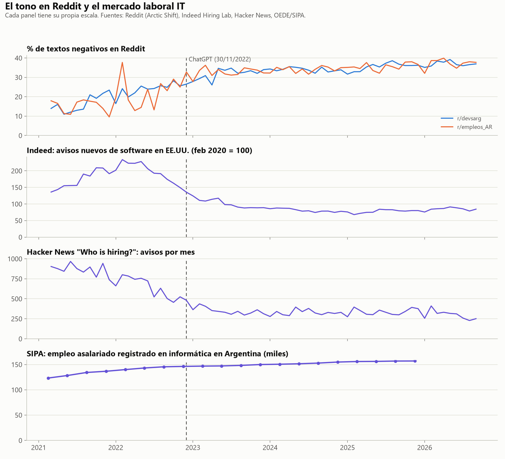

# 09. Cruce del tono con el mercado

Script: `scripts/analisis_cruce.py` (~10 segundos). Usa las series de `04_sentimiento.md` y `08_mercado.md`. Tabla en `reports/tablas/cruce_correlaciones.csv`.

## Pregunta

La hipótesis B dice que el sentimiento en Reddit se mueve junto con la cantidad de ofertas de software: cuando caen las ofertas, la conversación se vuelve más negativa.

## Método

Se compara el % de textos negativos por mes de r/devsarg y r/empleos_AR, de marzo de 2021 a septiembre de 2026 (67 meses), con tres medidas de mercado:

- Indeed, avisos nuevos de software en EE.UU.
- Hacker News "Who is hiring?", cantidad de avisos por mes.
- Hacker News, % de avisos junior.

Con SIPA (empleo registrado en informática en Argentina) la comparación es trimestral, 20 trimestres. Se excluye 2026-T1, que la fuente marca como subestimado.

Se usa la correlación de Spearman, que no supone una relación lineal. Dos series con tendencia aparecen correlacionadas aunque no tengan nada que ver: la negatividad sube y los avisos bajan durante el mismo período, por motivos que pueden ser distintos. Por eso se calculan dos correlaciones:

- **En niveles:** ¿los meses con menos avisos son los más negativos?
- **En variaciones** (diferencia mes a mes; interanual en SIPA): ¿cuando los avisos caen un mes, la negatividad sube ese mismo mes? Esta es la que pone a prueba la hipótesis, porque descuenta la tendencia común.

También se prueban rezagos de 0 a 6 meses (el mercado del mes t−k contra el tono del mes t), por si la conversación reacciona tarde.

## Resultados

Correlación de Spearman con el % de textos negativos de r/devsarg, sin rezago:

| Medida de mercado | En niveles | En variaciones |
|---|---|---|
| Indeed, avisos nuevos | −0,71 (p < 0,001) | 0,10 (p = 0,44) |
| Hacker News, avisos por mes | −0,79 (p < 0,001) | 0,08 (p = 0,51) |
| Hacker News, % de avisos junior | −0,20 (p = 0,11) | 0,07 (p = 0,60) |
| SIPA, empleo en informática (trimestral) | 0,94 (p < 0,001) | 0,23 (p = 0,38) |

En niveles, la relación es fuerte y va en la dirección de la hipótesis: los meses con menos avisos son los más negativos. Con rezagos de hasta 6 meses la correlación en niveles se mantiene (−0,71 a −0,80 con Indeed).

En variaciones no hay relación. Los meses en que caen los avisos no son los meses en que sube la negatividad, con ningún rezago entre 0 y 6. De las 42 correlaciones en variaciones (2 subs, 3 medidas mensuales, 7 rezagos), 4 dan p < 0,05, con signos que no coinciden entre sí. Por azar se esperan unas 2.

SIPA muestra el problema de las correlaciones en niveles. El empleo informático argentino crece todo el período, igual que la negatividad, y la correlación da 0,94. Nadie diría que más empleo vuelve más negativa la conversación: las dos series solo comparten la tendencia.

r/empleos_AR da resultados parecidos: entre −0,58 y −0,71 en niveles con Indeed y Hacker News, y nada consistente en variaciones.

## Lectura

Las dos curvas tienen la misma forma general. La negatividad sube durante 2021 y 2022 mientras los avisos caen desde su pico de principios de 2022, y las dos se estabilizan desde mediados de 2023. Eso es compatible con la hipótesis B a escala de años. Pero los datos no muestran que la conversación siga al mercado mes a mes. Además, la negatividad empieza a subir en 2021, cuando los avisos todavía estaban creciendo (ver `04_sentimiento.md`). La coincidencia de forma no alcanza para decir que una cosa sigue a la otra.

## Limitaciones

- **Las medidas de mercado no son argentinas.** Indeed es de EE.UU. y Hacker News, sobre todo de EE.UU. y Europa. Sirven porque una parte grande de los programadores argentinos trabaja para empresas de afuera, pero no miden el mercado local. SIPA sí es argentina, pero mide empleo y no ofertas.
- **Pocos puntos.** 67 meses y 20 trimestres. Una relación débil en variaciones podría existir y no detectarse.
- **Tono general, no tono sobre el mercado.** El % de textos negativos incluye conversaciones que no hablan de trabajo.

## Para la exposición

1. **La negatividad y los avisos se mueven juntos a escala de años, no de meses.** La correlación con los avisos de Indeed es −0,71 en niveles y 0,10 en variaciones mensuales. La hipótesis B solo se sostiene en la versión débil: las dos curvas cambian en el mismo período.
2. **La correlación en niveles engaña.** El empleo informático argentino crece todo el período y también correlaciona con la negatividad (0,94). Que dos series tengan tendencia no prueba que una siga a la otra.
